# Scitizia: 89 carros de rali low poly em glTF/GLB com visual retrô de 64 bits

▶️ **[Assista ao vídeo no YouTube](https://www.youtube.com/watch?v=G-UUvOGup1g)** · **[Baixe no itch.io](https://kkyqr.itch.io/scitizia-rally-fleet-64)** (grátis, doação opcional)

**Scitizia: frota 64 bits** é uma coleção gratuita de 89 carros de rali fictícios em baixo polígono (low poly), com o visual retrô dos consoles de 64 bits, prontos para jogos em tempo real. São 7 classes (C1 Novato a C7 Off-road), de hatches populares a picapes de rali cross-country, com modelos de 1974 a 2010 e nove tipos de carroceria com silhueta própria (hatch, sedã, perua, cupê, conversível, utilitário esportivo, picape, minivan, furgão). 12 deles são carros de rua de série de 4 marcas fictícias, com proporções e física de carros comuns de cada época. Cada carro é um arquivo glTF 2.0 binário (`.glb`) de 138 a 203 KB, com 2.788 a 3.698 triângulos, uma textura de 256×256 px para a carroceria e uma de 128×64 px para as rodas (os carros de rua têm mais uma, de 128×40 px, para as placas), rodas separadas para girar e esterçar e uma sombra plana. Os carros foram feitos para o jogo **Scitizia Rally Championship**; nomes, marcas, formas e pinturas são inventados, sem nenhum fabricante, modelo ou patrocinador real.

**English summary:** Scitizia 64-bit fleet is a free collection of 89 fictional low-poly rally cars with a retro 64-bit console look, in 7 classes (from small front-wheel-drive hatchbacks to cross-country rally pickups), including 12 stock street cars from 4 made-up brands. Every car is a binary glTF 2.0 (`.glb`) file with about 2,788 to 3,698 triangles, a 256×256 body texture and a 128×64 wheel texture, separate wheel objects for spinning and steering, and a blob shadow. Units are meters, Y is up and the car faces +Z. A machine-readable list of all cars is in [`catalogo.json`](catalogo.json).

## Resumo

| | |
|---|---|
| Carros | 89 em 7 classes (C1 19, C2 15, C3 11, C4 11, C5 11, C6 11, C7 11) |
| Formato | glTF 2.0 binário (`.glb`), texturas também em PNG |
| Triângulos por carro | 2.788 a 3.698 |
| Texturas | carroceria 256×256 px, rodas 128×64 px, placas 128×40 px (carros de rua) |
| Escala e eixos | metros, Y para cima, frente em +Z, esquerda em +X |
| Objetos | `Carroceria`, portas (`Porta_E`, `Porta_D`, `Porta_TE`, `Porta_TD`), `Capo` e `Tampa` com pivô na dobradiça, `Farol`, `Lanterna`, `Interior`, quatro rodas (`Roda_DE`, `Roda_DD`, `Roda_TE`, `Roda_TD`), `Sombra` |
| Anos dos modelos | 1974 a 2010 |
| Carrocerias | Hatch (31), Sedã (7), Perua (8), Cupê (10), Conversível (6), Utilitário esportivo (7), Picape (8), Minivan (7), Furgão (5) |
| Carros de rua de série | 12, das marcas fictícias Ardena, Castrel, Nimbo, Vortan |
| Catálogo legível por máquina | [`catalogo.json`](catalogo.json) |

## Carros por classe

As tabelas trazem o ano do modelo, a carroceria, o arquétipo, a tração (FWD dianteira, RWD traseira, AWD integral), a potência, a massa e o ID, o Índice de Desempenho do jogo (100 a 999), calculado a partir da ficha de física de cada carro. Dentro de cada classe os carros seguem a ordem dos anos. Os carros de rua de série trazem a marca fictícia ao lado do arquétipo.

### C1 Novato

Populares de rali e carros de rua de série, todos de tração dianteira e motor aspirado. Carrocerias: hatch, cupê, perua, picape, minivan, furgão, sedã, conversível, utilitário esportivo. 19 carros, ID de 300 a 395, potência de 58 a 116 cv, massa de 800 a 1.180 kg.

| Prévia | Carro | Ano | Carroceria | Arquétipo | Tração | Potência | Massa | ID |
|---|---|---|---|---|---|---|---|---|
|  | **Bombom 1.3** | 1974 | Hatch | Hatch pequeno de 3 portas (rua, Nimbo) | FWD | 61 cv | 820 kg | 319 |
|  | **Dengo 1.6** | 1977 | Cupê | Cupê médio de 2 portas (rua, Castrel) | FWD | 82 cv | 920 kg | 346 |
| 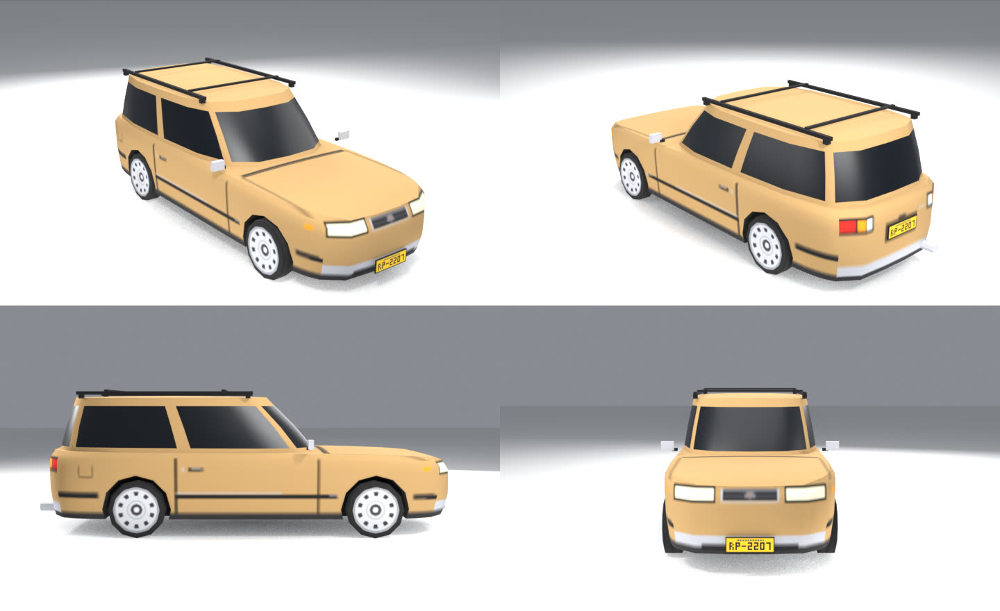 | **Rapadura 1.6** | 1982 | Perua | Perua média (rua, Castrel) | FWD | 75 cv | 960 kg | 318 |
|  | **Xodó 1.0** | 1991 | Hatch | Hatch compacto popular | FWD | 87 cv | 930 kg | 361 |
|  | **Cocada 1.0** | 1992 | Hatch | Hatch popular de linhas retas (rua, Nimbo) | FWD | 58 cv | 800 kg | 318 |
|  | **Miúdo 1.4** | 1993 | Hatch | Hatch compacto popular | FWD | 95 cv | 1.000 kg | 373 |
|  | **Pipoca 1.3** | 1994 | Perua | Perua compacta popular | FWD | 95 cv | 1.070 kg | 349 |
| 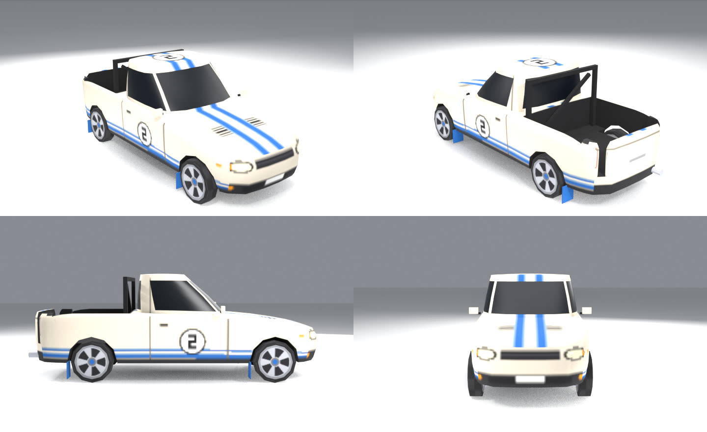 | **Cuscuz 1.4** | 1996 | Picape | Picape compacta | FWD | 92 cv | 1.060 kg | 329 |
| 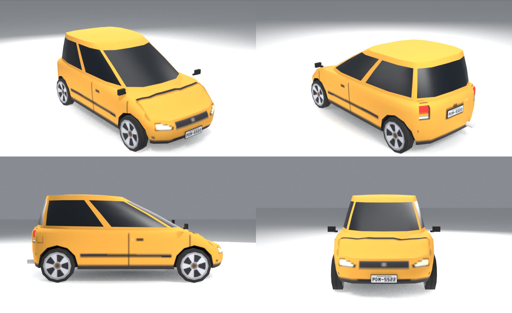 | **Pudim 1.6** | 1996 | Minivan | Monovolume compacto de piso duplo (rua, Ardena) | FWD | 102 cv | 1.120 kg | 368 |
|  | **Pirulito 1.0** | 1997 | Hatch | Hatch compacto popular (rua, Castrel) | FWD | 60 cv | 880 kg | 312 |
|  | **Cafuné 1.0** | 1998 | Furgão | Furgão compacto de entregas | FWD | 91 cv | 1.140 kg | 300 |
|  | **Quindim 1.6** | 1999 | Sedã | Sedã compacto popular | FWD | 103 cv | 1.090 kg | 379 |
|  | **Brigadeiro 1.8** | 1999 | Hatch | Hatch médio de linhas angulosas (rua, Castrel) | FWD | 116 cv | 1.180 kg | 394 |
| 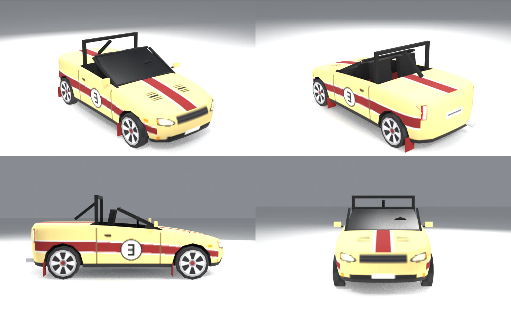 | **Canjica 1.6** | 2001 | Conversível | Conversível compacto | FWD | 99 cv | 1.000 kg | 395 |
| 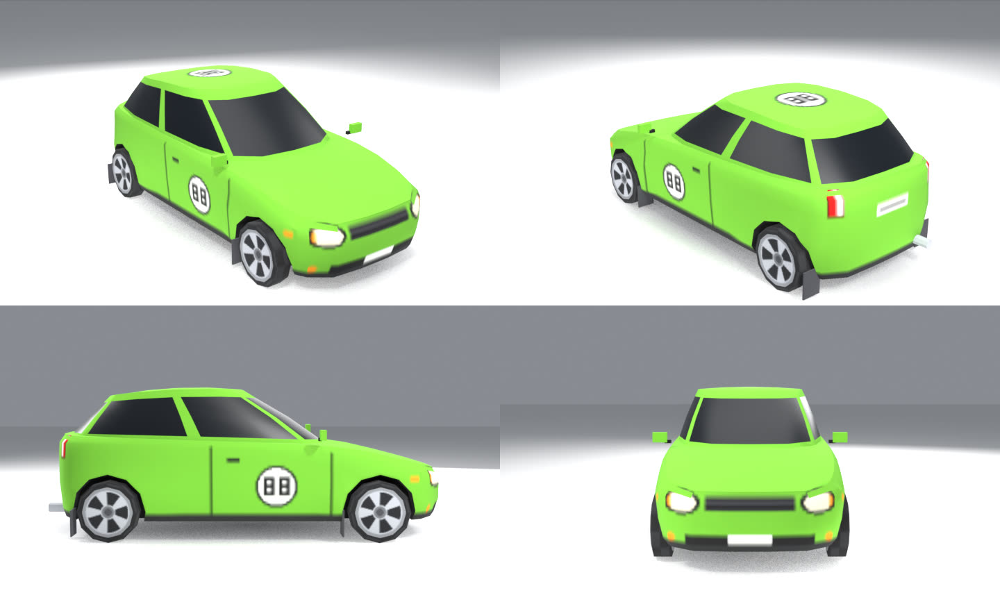 | **Jujuba 1.0** | 2002 | Hatch | Subcompacto de linhas arredondadas (rua, Castrel) | FWD | 65 cv | 900 kg | 327 |
| 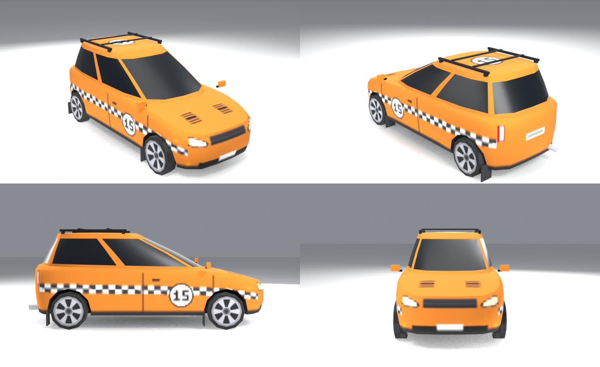 | **Paçoca 1.4** | 2002 | Minivan | Monovolume compacto popular | FWD | 95 cv | 1.070 kg | 358 |
|  | **Guri 1.4** | 2003 | Hatch | Hatch compacto popular | FWD | 98 cv | 1.020 kg | 373 |
| 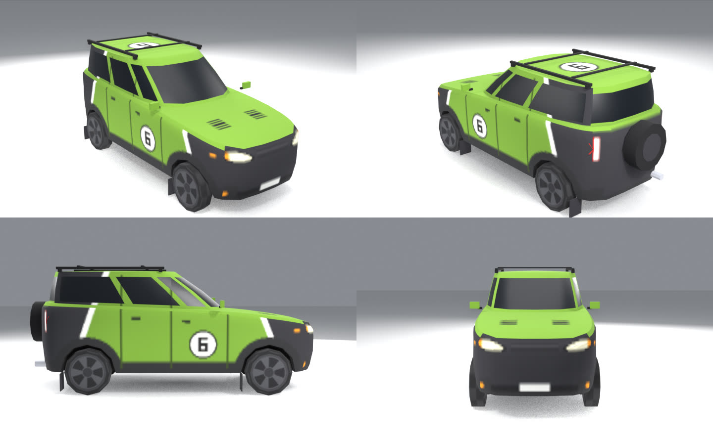 | **Pamonha 1.6** | 2007 | Utilitário esportivo | Utilitário esportivo compacto | FWD | 101 cv | 1.130 kg | 330 |
|  | **Chuchu 1.6** | 2008 | Hatch | Hatch compacto aventureiro | FWD | 103 cv | 1.080 kg | 372 |

### C2 Kit Car

Esportivos preparados (kit car) e hatches médios esportivos de série, tração dianteira e motor aspirado ou turbo. Carrocerias: hatch, conversível, cupê, picape, sedã, perua, minivan. 15 carros, ID de 412 a 560, potência de 105 a 173 cv, massa de 940 a 1.230 kg.

| Prévia | Carro | Ano | Carroceria | Arquétipo | Tração | Potência | Massa | ID |
|---|---|---|---|---|---|---|---|---|
|  | **Fósforo 16** | 1983 | Hatch | Hatch esportivo de 3 portas (rua, Castrel) | FWD | 105 cv | 950 kg | 412 |
|  | **Rastilho 18** | 1984 | Hatch | Hatch médio esportivo de 3 portas (rua, Vortan) | FWD | 112 cv | 940 kg | 435 |
| 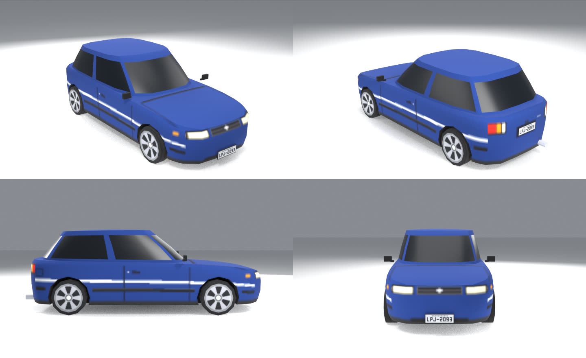 | **Lampejo 20** | 1991 | Hatch | Hatch médio esportivo (rua, Vortan) | FWD | 150 cv | 1.150 kg | 480 |
| 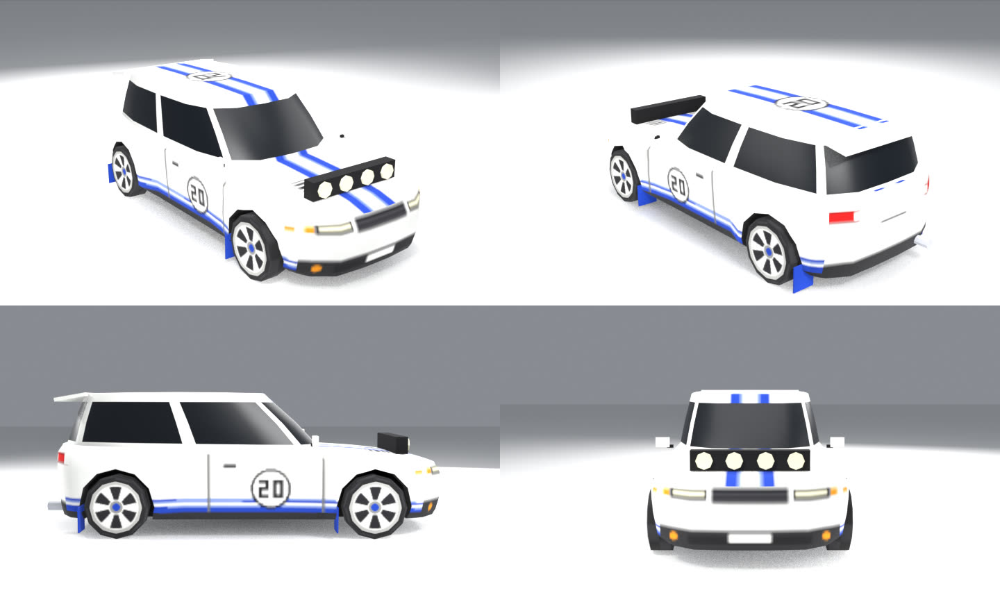 | **Fagulha 20** | 1992 | Hatch | Hatch esportivo preparado (kit car) | FWD | 156 cv | 950 kg | 556 |
|  | **Pirilampo 18** | 1993 | Conversível | Conversível esportivo preparado (kit car) | FWD | 150 cv | 1.000 kg | 521 |
|  | **Faísca KC** | 1994 | Hatch | Hatch esportivo preparado (kit car) | FWD | 156 cv | 1.000 kg | 540 |
|  | **Chispa 18** | 1995 | Cupê | Cupê esportivo preparado (kit car) | FWD | 144 cv | 980 kg | 513 |
|  | **Centelha 2.0** | 1997 | Hatch | Hatch esportivo preparado (kit car) | FWD | 165 cv | 1.030 kg | 551 |
| 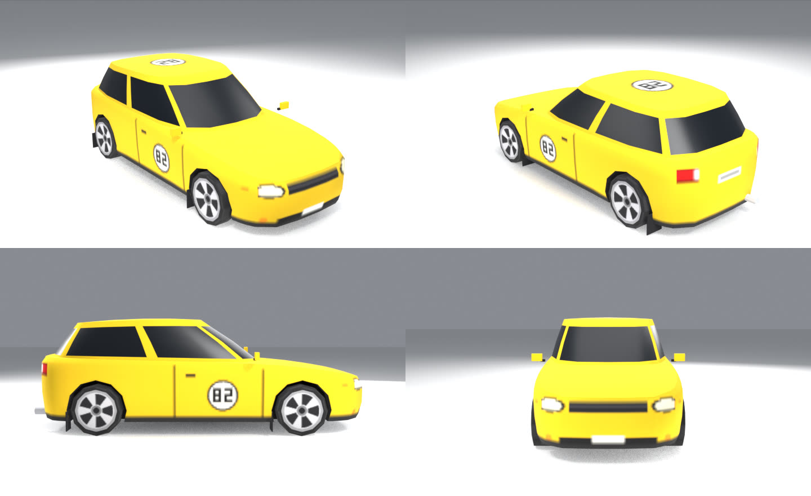 | **Pólvora 18** | 1998 | Hatch | Hatch médio esportivo turbo (rua, Vortan) | FWD | 150 cv | 1.230 kg | 463 |
|  | **Isqueiro 18** | 1999 | Picape | Picape compacta esportiva preparada | FWD | 156 cv | 1.050 kg | 493 |
|  | **Pavio 2.0** | 2000 | Sedã | Sedã esportivo preparado (kit car) | FWD | 152 cv | 1.000 kg | 527 |
|  | **Estopim 1.8** | 2002 | Perua | Perua esportiva preparada (kit car) | FWD | 159 cv | 1.050 kg | 520 |
|  | **Tocha 20** | 2003 | Minivan | Minivan esportiva preparada | FWD | 163 cv | 1.080 kg | 495 |
|  | **Labareda 2.0** | 2004 | Hatch | Hatch esportivo preparado (kit car) | FWD | 169 cv | 1.050 kg | 553 |
| 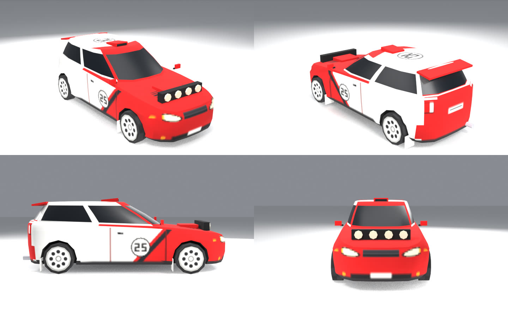 | **Rojão 2.0** | 2009 | Hatch | Hatch esportivo preparado (kit car) | FWD | 173 cv | 1.060 kg | 560 |

### C3 Clássico

Tração traseira, motores aspirados de 2.4 a 3.5. Carrocerias: cupê, picape, hatch, perua, conversível, furgão, sedã, utilitário esportivo. 11 carros, ID de 446 a 572, potência de 162 a 188 cv, massa de 1.000 a 1.240 kg.

| Prévia | Carro | Ano | Carroceria | Arquétipo | Tração | Potência | Massa | ID |
|---|---|---|---|---|---|---|---|---|
| 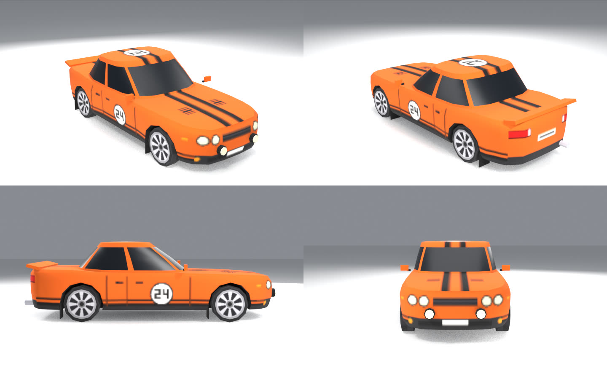 | **Brasa 24** | 1986 | Cupê | Cupê de tração traseira | RWD | 170 cv | 1.050 kg | 529 |
| 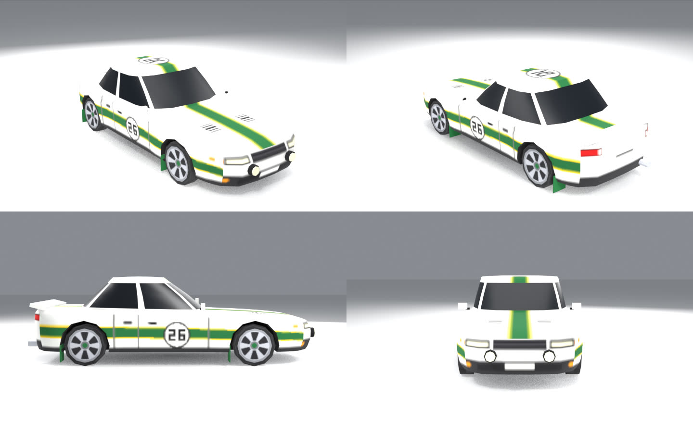 | **Braseiro 25** | 1990 | Cupê | Cupê de tração traseira | RWD | 162 cv | 1.020 kg | 521 |
|  | **Tição 30** | 1993 | Picape | Picape esportiva de tração traseira | RWD | 178 cv | 1.240 kg | 465 |
| 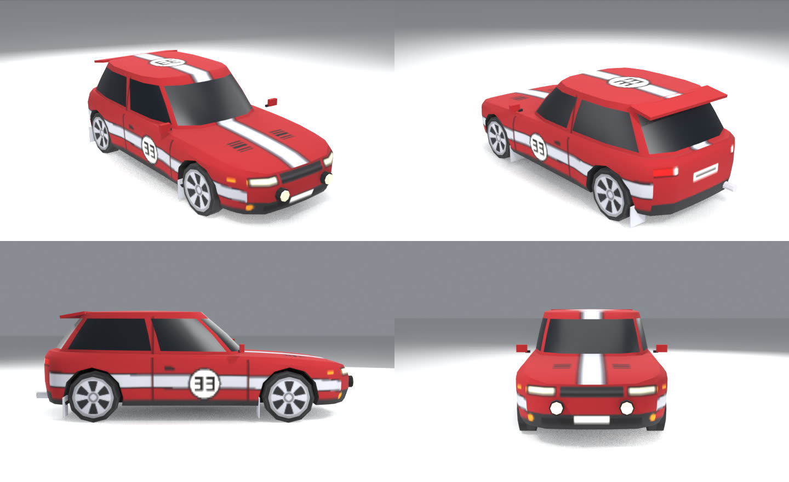 | **Caldeira 28** | 1995 | Hatch | Hatch de tração traseira | RWD | 167 cv | 1.000 kg | 542 |
| 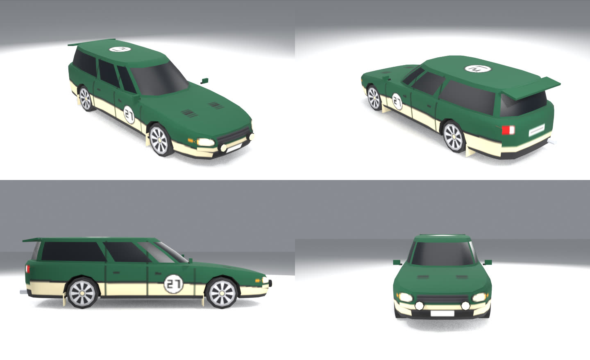 | **Forja 26** | 1996 | Perua | Perua de tração traseira | RWD | 165 cv | 1.180 kg | 471 |
|  | **Fornalha 28** | 1998 | Conversível | Conversível de tração traseira | RWD | 174 cv | 1.030 kg | 552 |
|  | **Borralho 30** | 2000 | Furgão | Furgão de tração traseira preparado | RWD | 174 cv | 1.200 kg | 446 |
| 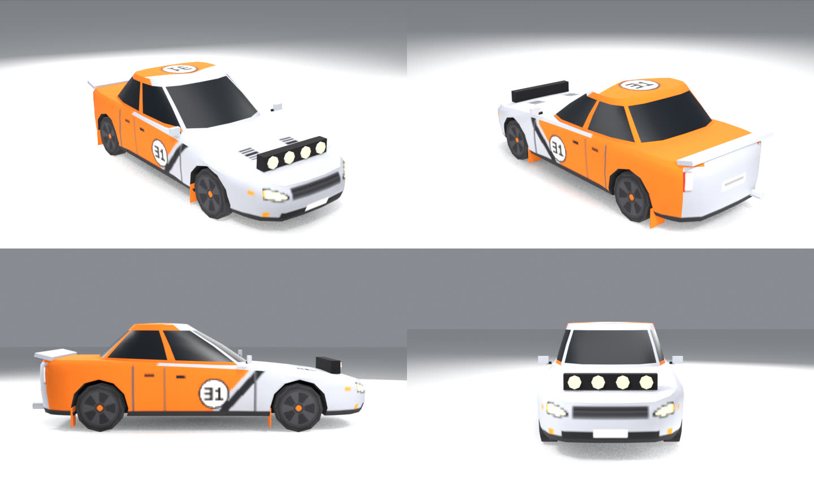 | **Candeia 30** | 2003 | Sedã | Sedã de tração traseira | RWD | 184 cv | 1.080 kg | 550 |
|  | **Lampião 32** | 2005 | Cupê | Cupê de tração traseira | RWD | 188 cv | 1.050 kg | 572 |
| 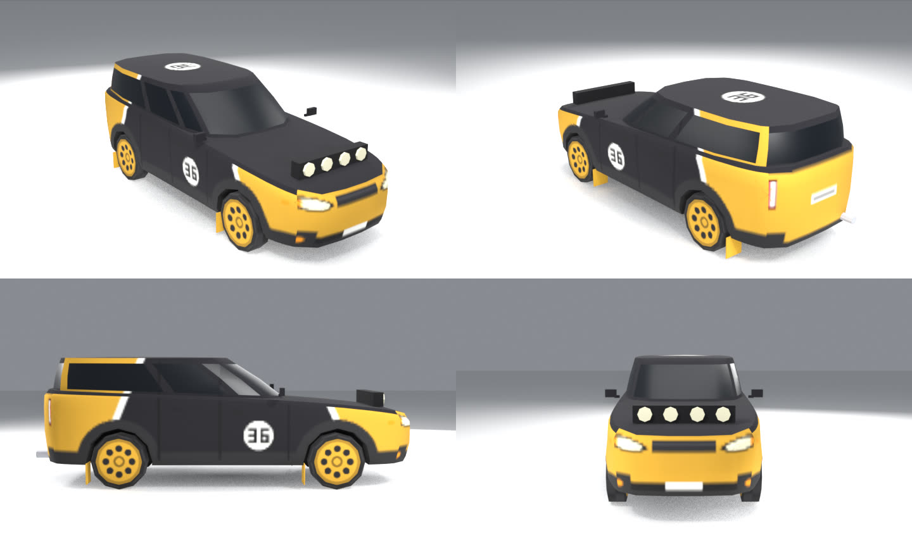 | **Rescaldo 32** | 2006 | Utilitário esportivo | Utilitário esportivo de tração traseira | RWD | 181 cv | 1.180 kg | 479 |
|  | **Fogareiro 35** | 2007 | Cupê | Cupê de tração traseira | RWD | 185 cv | 1.110 kg | 547 |

### C4 Produção

Carros de série com tração integral e motor turbo. Carrocerias: sedã, perua, cupê, picape, conversível, minivan, utilitário esportivo, hatch, furgão. 11 carros, ID de 541 a 640, potência de 190 a 224 cv, massa de 1.240 a 1.520 kg.

| Prévia | Carro | Ano | Carroceria | Arquétipo | Tração | Potência | Massa | ID |
|---|---|---|---|---|---|---|---|---|
|  | **Relâmpago 20** | 1991 | Sedã | Sedã 4x4 turbo | AWD | 190 cv | 1.240 kg | 599 |
|  | **Trovão 4T** | 1992 | Sedã | Sedã de série 4x4 turbo | AWD | 204 cv | 1.300 kg | 605 |
|  | **Trovoada 22** | 1993 | Perua | Perua 4x4 turbo | AWD | 199 cv | 1.290 kg | 604 |
|  | **Temporal 20** | 1997 | Cupê | Cupê 4x4 turbo | AWD | 215 cv | 1.270 kg | 638 |
| 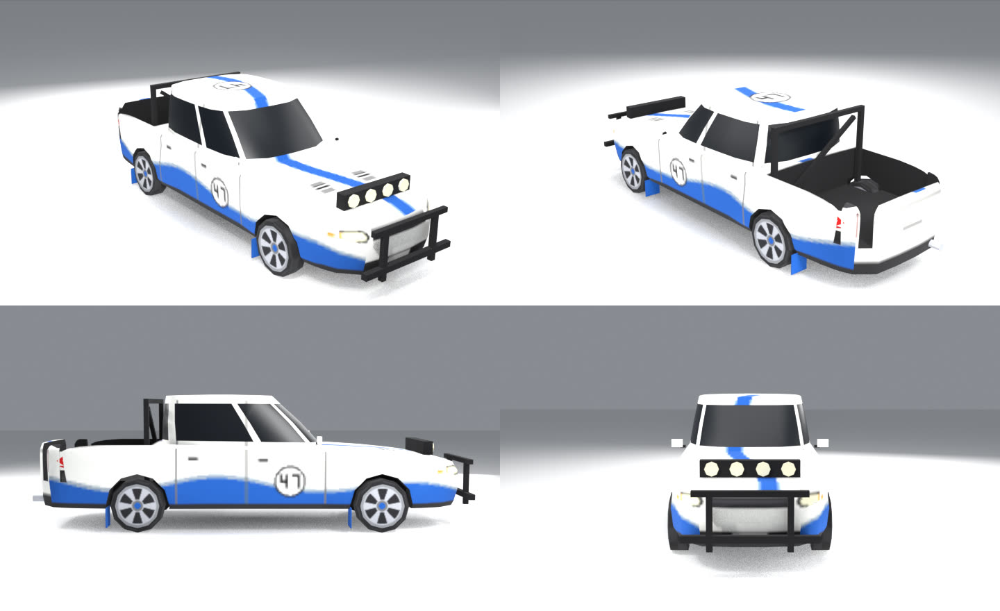 | **Granizo 22** | 1998 | Picape | Picape cabine dupla 4x4 turbo | AWD | 215 cv | 1.440 kg | 571 |
|  | **Rajada 20** | 1999 | Conversível | Conversível 4x4 turbo | AWD | 208 cv | 1.250 kg | 627 |
|  | **Tormenta 25** | 2002 | Perua | Perua 4x4 turbo | AWD | 215 cv | 1.390 kg | 602 |
|  | **Aguaceiro 20** | 2003 | Minivan | Minivan 4x4 turbo | AWD | 216 cv | 1.440 kg | 558 |
|  | **Borrasca 20** | 2004 | Utilitário esportivo | Utilitário esportivo 4x4 turbo | AWD | 224 cv | 1.520 kg | 551 |
|  | **Corisco 20** | 2007 | Hatch | Hatch 4x4 turbo | AWD | 220 cv | 1.270 kg | 640 |
| 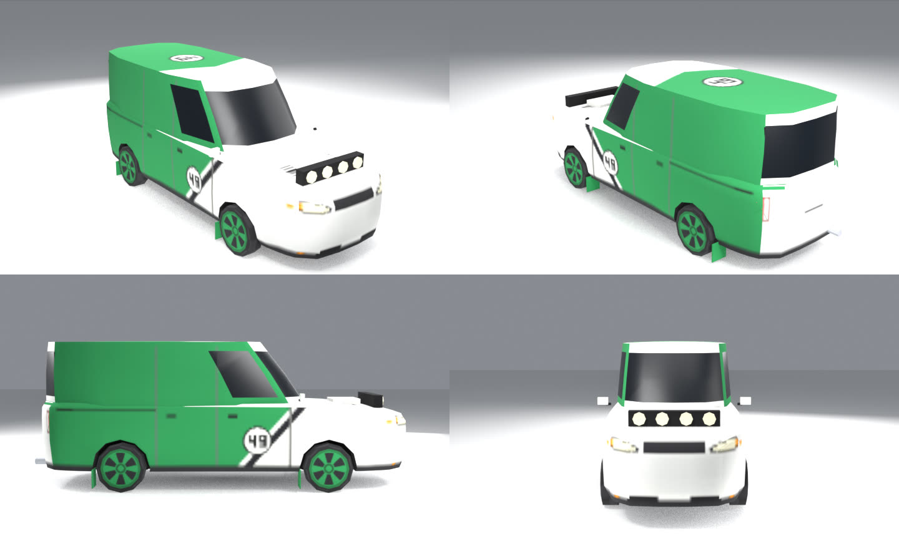 | **Chuvarada 25** | 2008 | Furgão | Furgão 4x4 turbo | AWD | 220 cv | 1.470 kg | 541 |

### C5 Elite

Protótipos de rali, tração integral e motor 1.6 turbo. Carrocerias: hatch, cupê, sedã, minivan, perua, picape, utilitário esportivo. 11 carros, ID de 647 a 747, potência de 218 a 249 cv, massa de NaN a NaN kg.

| Prévia | Carro | Ano | Carroceria | Arquétipo | Tração | Potência | Massa | ID |
|---|---|---|---|---|---|---|---|---|
|  | **Quartzo 16** | 1992 | Hatch | Protótipo de rali sobre base de hatch | AWD | 218 cv | 1.090 kg | 702 |
| 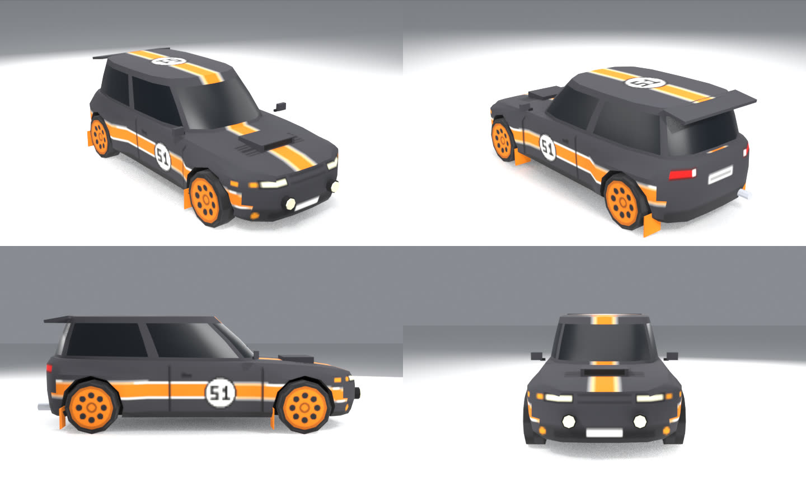 | **Basalto 16** | 1995 | Cupê | Protótipo de rali sobre base de cupê | AWD | 233 cv | 1.130 kg | 725 |
|  | **Granito 16** | 1997 | Sedã | Protótipo de rali sobre base de sedã | AWD | 224 cv | 1.230 kg | 668 |
|  | **Malaquita 16** | 1999 | Minivan | Protótipo de rali sobre base de minivan | AWD | 238 cv | 1.270 kg | 650 |
|  | **Turmalina 16** | 2000 | Hatch | Protótipo de rali sobre base de hatch | AWD | 242 cv | 1.120 kg | 746 |
|  | **Jaspe 16** | 2001 | Perua | Protótipo de rali sobre base de perua | AWD | 228 cv | 1.290 kg | 647 |
| 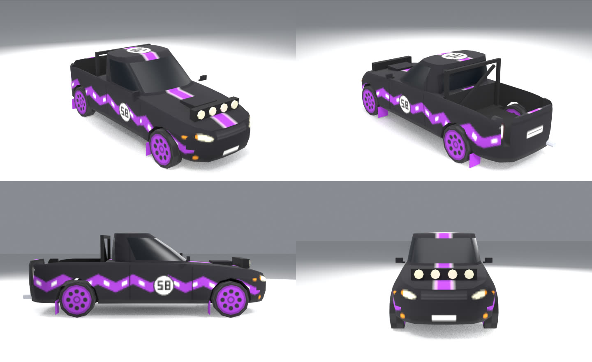 | **Obsidiana 16** | 2003 | Picape | Protótipo de rali sobre base de picape | AWD | 239 cv | 1.200 kg | 679 |
| 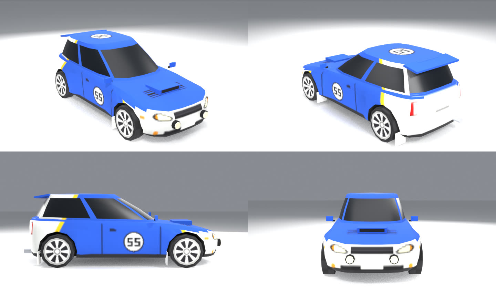 | **Ágata 16** | 2004 | Hatch | Protótipo de rali sobre base de hatch | AWD | 249 cv | 1.150 kg | 747 |
|  | **Citrino 16** | 2006 | Utilitário esportivo | Protótipo de rali sobre base de utilitário esportivo | AWD | 242 cv | 1.270 kg | 653 |
|  | **Scitizia R5** | 2008 | Hatch | Protótipo de rali sobre base de hatch | AWD | 228 cv | NaN kg | 708 |
|  | **Ametista 16** | 2009 | Hatch | Protótipo de rali sobre base de hatch | AWD | 238 cv | 1.170 kg | 718 |

### C6 Grupo Livre

Monstros sem restrição, tração integral e motores turbo de 2.1 a 2.7. Carrocerias: hatch, furgão, cupê, sedã, minivan, conversível, utilitário esportivo. 11 carros, ID de 792 a 917, potência de 282 a 337 cv, massa de 1.030 a 1.250 kg.

| Prévia | Carro | Ano | Carroceria | Arquétipo | Tração | Potência | Massa | ID |
|---|---|---|---|---|---|---|---|---|
|  | **Vendaval B** | 1985 | Hatch | Monstro sem restrição sobre base de hatch | AWD | 306 cv | 1.100 kg | 896 |
|  | **Ventania 21** | 1991 | Hatch | Monstro sem restrição sobre base de hatch | AWD | 301 cv | 1.030 kg | 909 |
|  | **Lestada 22** | 1993 | Furgão | Monstro sem restrição sobre base de furgão | AWD | 318 cv | 1.250 kg | 792 |
|  | **Redemoinho 22** | 1994 | Cupê | Monstro sem restrição sobre base de cupê | AWD | 330 cv | 1.080 kg | 917 |
| 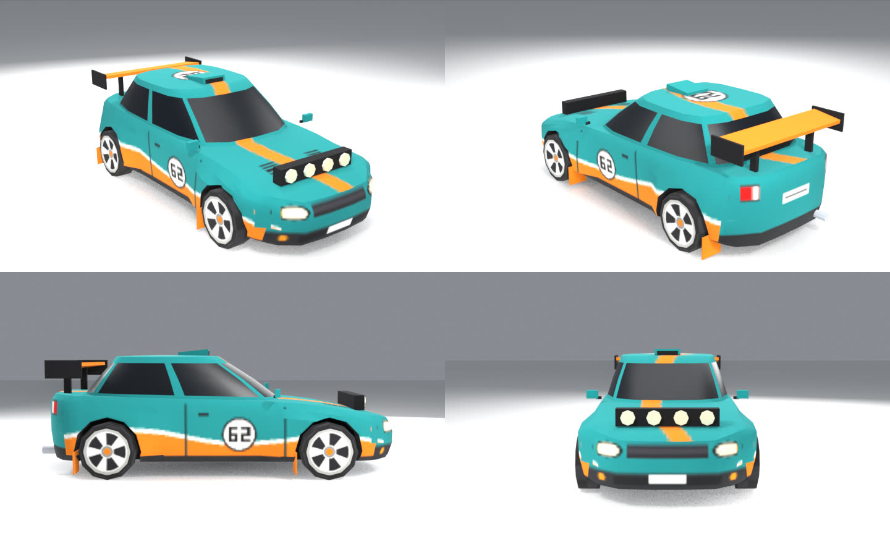 | **Minuano 23** | 1996 | Sedã | Monstro sem restrição sobre base de sedã | AWD | 282 cv | 1.180 kg | 805 |
| 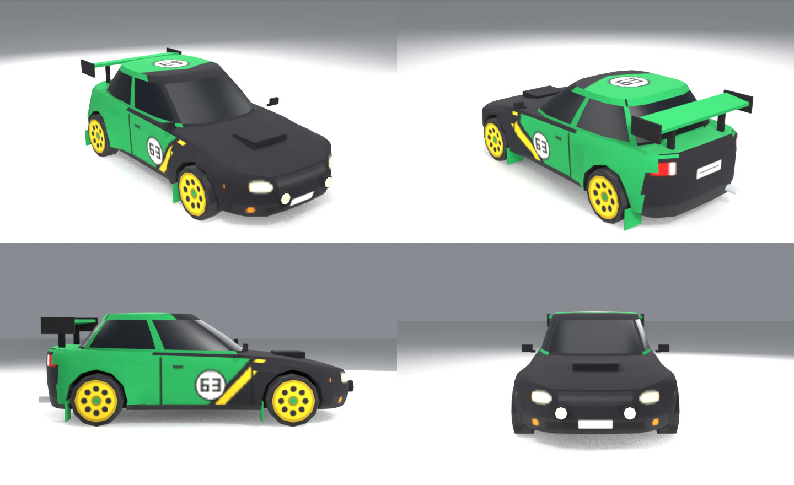 | **Lufada 24** | 1999 | Hatch | Monstro sem restrição sobre base de hatch | AWD | 318 cv | 1.060 kg | 914 |
| 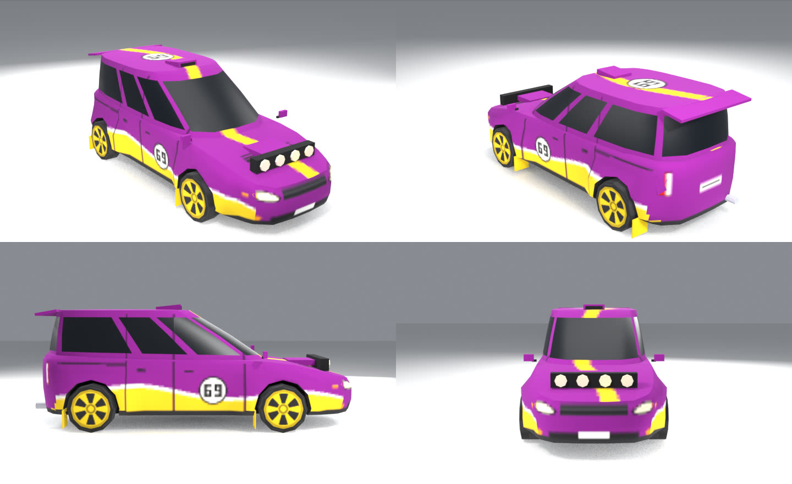 | **Rabanada 24** | 2001 | Minivan | Monstro sem restrição sobre base de minivan | AWD | 325 cv | 1.220 kg | 839 |
|  | **Procela 25** | 2003 | Conversível | Monstro sem restrição sobre base de conversível | AWD | 337 cv | 1.200 kg | 907 |
|  | **Rebojo 26** | 2005 | Hatch | Monstro sem restrição sobre base de hatch | AWD | 294 cv | 1.100 kg | 869 |
|  | **Aracati 25** | 2008 | Utilitário esportivo | Monstro sem restrição sobre base de utilitário esportivo | AWD | 318 cv | 1.210 kg | 825 |
|  | **Terral 27** | 2010 | Hatch | Monstro sem restrição sobre base de hatch | AWD | 325 cv | 1.190 kg | 893 |

### C7 Off-road

Rali cross-country, tração integral, os carros mais pesados da frota. Carrocerias: furgão, conversível, picape, hatch, utilitário esportivo, perua, minivan, cupê. 11 carros, ID de 475 a 590, potência de 231 a 277 cv, massa de 1.630 a 2.050 kg.

| Prévia | Carro | Ano | Carroceria | Arquétipo | Tração | Potência | Massa | ID |
|---|---|---|---|---|---|---|---|---|
| 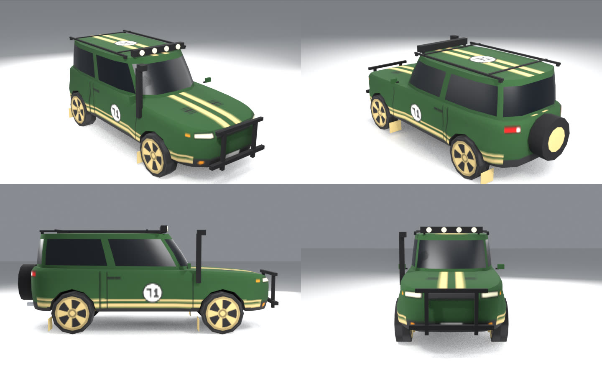 | **Lajedo 32** | 1990 | Furgão | Furgão de rali cross-country | AWD | 239 cv | 2.000 kg | 475 |
|  | **Atoleiro 31** | 1992 | Conversível | Utilitário aberto de rali cross-country | AWD | 231 cv | 1.630 kg | 542 |
|  | **Jararaca 30** | 1995 | Picape | Picape de rali cross-country | AWD | 252 cv | 1.900 kg | 521 |
|  | **Baixio 28** | 1996 | Hatch | Hatch elevado 4x4 de rali cross-country | AWD | 246 cv | 1.680 kg | 556 |
|  | **Boqueirão 34** | 1997 | Utilitário esportivo | Utilitário esportivo de rali cross-country | AWD | 264 cv | 1.860 kg | 543 |
|  | **Chapada 33** | 1998 | Perua | Perua 4x4 de rali cross-country | AWD | 252 cv | 2.030 kg | 506 |
|  | **Grota 35** | 2001 | Picape | Picape cabine dupla de rali cross-country | AWD | 272 cv | 2.030 kg | 530 |
|  | **Vereda 30** | 2004 | Minivan | Minivan 4x4 de rali cross-country | AWD | 252 cv | 1.810 kg | 541 |
|  | **Caatinga 36** | 2005 | Utilitário esportivo | Utilitário esportivo de rali cross-country | AWD | 257 cv | 1.900 kg | 528 |
|  | **Tabuleiro 37** | 2008 | Picape | Picape cabine dupla de rali cross-country | AWD | 277 cv | 2.050 kg | 534 |
| 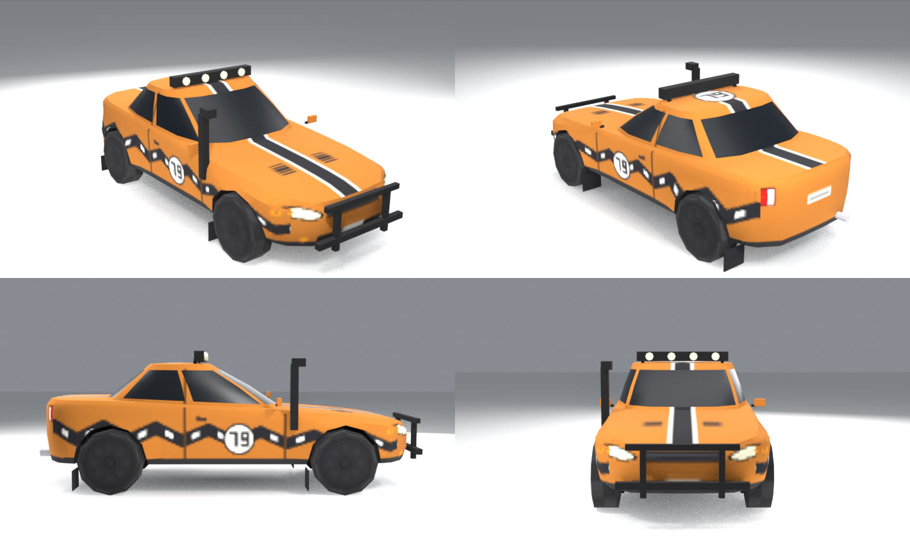 | **Serrote 32** | 2009 | Cupê | Cupê elevado 4x4 de rali cross-country | AWD | 267 cv | 1.750 kg | 590 |

## Carros de rua de série

Os 12 carros de rua usam proporções de carros comuns de cada época (comprimento, entre-eixos, altura, balanço, rodas pequenas de aro 13 a 16) e física de carro de série: massa, potência, torque, escalonamento de marchas e relação final do tipo de carro. As marcas são inventadas e aparecem no campo `marca` da ficha e do catálogo. Eles saem com acabamento de série (`"decoracao": "rua"` na ficha): sem número de competição, faixas no capô, faróis de milha nem para-barros, com placa de época inventada (amarela até os anos 80, cinza depois), frisos, maçanetas, lanternas com moldura, retrovisores pretos ou cromados, calotas e pneus de rua.

| Carro | Classe | Marca fictícia | Ano | Carroceria | Tipo de carro |
|---|---|---|---|---|---|
| **Bombom 1.3** | C1 | Nimbo | 1974 | Hatch | Hatch pequeno de 3 portas |
| **Dengo 1.6** | C1 | Castrel | 1977 | Cupê | Cupê médio de 2 portas |
| **Rapadura 1.6** | C1 | Castrel | 1982 | Perua | Perua média |
| **Cocada 1.0** | C1 | Nimbo | 1992 | Hatch | Hatch popular de linhas retas |
| **Pudim 1.6** | C1 | Ardena | 1996 | Minivan | Monovolume compacto de piso duplo |
| **Pirulito 1.0** | C1 | Castrel | 1997 | Hatch | Hatch compacto popular |
| **Brigadeiro 1.8** | C1 | Castrel | 1999 | Hatch | Hatch médio de linhas angulosas |
| **Jujuba 1.0** | C1 | Castrel | 2002 | Hatch | Subcompacto de linhas arredondadas |
| **Fósforo 16** | C2 | Castrel | 1983 | Hatch | Hatch esportivo de 3 portas |
| **Rastilho 18** | C2 | Vortan | 1984 | Hatch | Hatch médio esportivo de 3 portas |
| **Lampejo 20** | C2 | Vortan | 1991 | Hatch | Hatch médio esportivo |
| **Pólvora 18** | C2 | Vortan | 1998 | Hatch | Hatch médio esportivo turbo |

## Estilo de cada período

O período do ano de cada carro aparece nas proporções e nos detalhes da carroceria:

- **anos 1970**: carrocerias baixas de linhas retas, faróis redondos ou retangulares e para-choques cromados;
- **anos 1980**: carrocerias retas de cantos vivos, faróis retangulares ou redondos, para-choques escuros ou cromados e, nos carros de rali, muitos acessórios;
- **anos 1990-1995**: linhas retas, para-brisa mais em pé, faróis retangulares finos e para-choques escuros;
- **anos 1996-2000**: formas arredondadas, faróis ovais, cintura baixa; os de linhas angulosas têm teto em arco e lanternas altas;
- **anos 2001-2005**: carrocerias mais altas, para-brisa mais deitado, faróis em gota e para-choques na cor do carro;
- **anos 2006-2010**: cintura alta, janelas menores, faróis grandes e puxados; os aventureiros ganham protetores de plástico.

## Pastas

- `modelos/<id>.glb`: o carro pronto para uso em tempo real.
- `texturas/<id>_carroceria.png` e `texturas/<id>_roda.png` (e `texturas/<id>_placa.png` nos carros de rua): as texturas em PNG (as mesmas que vão dentro do `.glb`).
- `texturas_hd/<id>_carroceria.webp`, `<id>_roda.webp` (e `<id>_placa.webp`): as mesmas texturas oito vezes maiores (2048×2048, 1024×512 e 1024×320 px), pintadas de novo pelo gerador com detalhe que só aparece de perto (juntas, borrachas dos vidros, rebites, desgaste, grão da pintura, desenho do pneu, porcas, letras lisas na placa). Usam o mesmo mapeamento UV: basta trocar a imagem do material.
- `previas/<id>.jpg`: quatro vistas de cada carro.
- `fichas/<id>.json`: ficha do carro no jogo, com nome, classe, ano, carroceria, arquétipo, motor e tração (e a marca fictícia, nos carros de rua). A seção `fisica` traz massa, medidas, eixos, bitolas, rodas, potência e tração; a seção `forma` traz os parâmetros que geram a carroceria (perfil, cabine, faróis, cores, pintura e acessórios).
- `catalogo.json`: lista dos 89 carros com classe, ano, carroceria, arquétipo, tração, potência, massa, ID e os caminhos do modelo, da prévia, da ficha e das texturas.
- `docs/`: imagem de capa.

## Como usar os modelos

- Metros, eixo Y para cima. A frente do carro aponta para +Z e a esquerda para +X. A origem fica no chão, entre os eixos.
- Objetos de cada arquivo:
  - `Carroceria`: carroceria, vidros e acessórios fixos, com vários materiais.
  - `Porta_E`, `Porta_D` (e `Porta_TE`, `Porta_TD` nos de 4 portas), `Capo` e `Tampa` (ou `Tampa_E`/`Tampa_D` nos furgões): nós vazios na dobradiça com a malha filha `<nome>_malha`. Fechados, ficam no lugar exato da lataria. Os `extras` do nó dizem como abrir: `movimento` ("giro" ou "corre"), `eixo` e `angulo` (graus, no referencial do arquivo) ou `desloca` (metros, porta corrediça).
  - `Farol` e `Lanterna`: películas sobre as lentes, com materiais próprios (`Farol`, `Lanterna`), para acender com emissão. `Interior`: caixas escuras por dentro, que aparecem quando uma peça abre.
  - `Roda_DE`, `Roda_DD`, `Roda_TE`, `Roda_TD`: as quatro rodas (dianteira/traseira, esquerda/direita), com a origem no centro da roda. Gire em torno do eixo X para rodar e em torno de Y para esterçar.
  - `Pinca_XX` (só no Scitizia R5): pinças de freio, que esterçam mas não giram.
  - `Sombra`: uma mancha escura com transparência para pôr no chão sob o carro.
- Materiais sem brilho combinam com o visual: difuso simples, filtro bilinear e neblina por distância.

## Perguntas frequentes

**Em que formato estão os carros?**
Em glTF 2.0 binário (`.glb`), um arquivo por carro, com malhas, materiais e texturas embutidos. As texturas também estão soltas em PNG na pasta `texturas/`.

**Qual a escala e a orientação dos modelos?**
A escala é em metros, com Y para cima, a frente do carro em +Z e a esquerda em +X. A origem fica no chão, no meio do entre-eixos.

**Posso importar em qualquer motor de jogo ou programa 3D?**
Sim, em qualquer motor, biblioteca web ou editor 3D que leia glTF 2.0. Não há extensões proprietárias: só malhas, materiais simples e texturas PNG.

**Quantos triângulos tem cada carro?**
Entre 2.788 e 3.698 triângulos, contando carroceria, rodas e sombra. Os arquivos têm de 138 a 203 KB.

**Que texturas os carros usam?**
Uma textura de 256×256 px para a carroceria (pintura, faróis, números e detalhes) e uma de 128×64 px para as rodas; os carros de rua têm mais uma, de 128×40 px, com a placa. O visual pede filtro bilinear e materiais sem brilho. Para ver de perto, a pasta `texturas_hd/` traz as mesmas texturas em alta (WebP, 8× maiores), com o mesmo UV.

**As rodas giram e esterçam?**
Sim. Cada roda é um objeto separado com a origem no centro: gire em torno do eixo X para rodar e em torno do eixo Y para esterçar.

**Os carros copiam modelos reais?**
Não. Todos os carros, nomes, marcas e pinturas são fictícios, inspirados só em arquétipos genéricos (hatch popular, kit car, cupê de tração traseira, sedã 4x4 turbo, protótipo, picape cross-country, carros de rua comuns de cada época), sem fabricante, modelo ou patrocinador real.

**O que tem nas fichas JSON?**
Cada `fichas/<id>.json` traz identificação (nome, classe, ano, carroceria, arquétipo, motor, tração e, nos carros de rua, a marca fictícia e o torque), a seção `fisica` usada pelo jogo (massa, medidas, eixos, bitolas, raio das rodas, potência, marchas) e a seção `forma`, com os parâmetros que geram a carroceria.

**O que é o ID das tabelas?**
É o Índice de Desempenho do jogo, de 100 a 999, que combina relação peso/potência, velocidade máxima, tração, dirigibilidade e frenagem. Serve para comparar carros de classes diferentes.

**Como listar os carros num programa?**
Leia o [`catalogo.json`](catalogo.json): ele traz os 89 carros com todos os dados das tabelas e os caminhos dos arquivos de cada um.

## Licença

[CC0 1.0 Universal](LICENSE): domínio público.

## Como citar

Os metadados de citação estão em [`CITATION.cff`](CITATION.cff).
