# Scitizia: frota 64 bits

Carros de rali em poucos polígonos, no visual dos consoles de 64 bits, feitos para o jogo **Scitizia Rally Championship**. Todos os carros, nomes e pinturas são inventados: nenhum fabricante, modelo ou patrocinador real aparece aqui.

Cada carro tem entre 2 e 2,5 mil triângulos, uma textura de 256 px para a carroceria e uma de 128×64 px para as rodas.

| | Carro | Classe | Arquétipo | Tração | Potência | Massa | ID |
|---|---|---|---|---|---|---|---|
|  | **Miúdo 1.4** | C1 Novato | Hatch compacto popular | FWD | 95 cv | 1.000 kg | 373 |
| 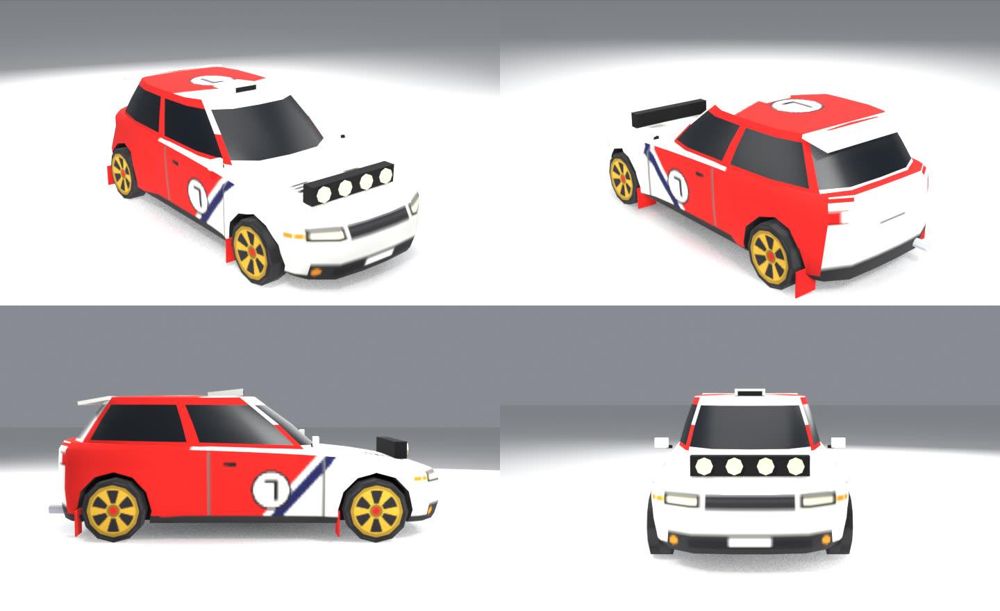 | **Faísca KC** | C2 Kit Car | Hatch esportivo preparado | FWD | 156 cv | 1.000 kg | 540 |
|  | **Brasa 24** | C3 Clássico | Cupê de tração traseira dos anos 70/80 | RWD | 170 cv | 1.050 kg | 529 |
|  | **Trovão 4T** | C4 Produção | Sedã de série 4x4 turbo | AWD | 204 cv | 1.300 kg | 605 |
|  | **Scitizia R5** | C5 Elite | Protótipo de rali sobre base de hatch | AWD | 228 cv | 1.150 kg | 708 |
|  | **Vendaval B** | C6 Grupo Livre | Monstro sem restrição, estilo anos 80 | AWD | 306 cv | 1.100 kg | 896 |
| 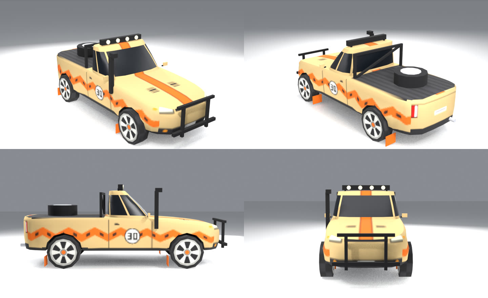 | **Jararaca 30** | C7 Off-road | Picape de rali cross-country | AWD | 252 cv | 1.900 kg | 521 |

ID é o Índice de Desempenho do jogo (100 a 999).

## Frota ampliada: 49 carros de época

Mais sete carros por classe, todos gerados pelo mesmo processo dos originais. Em cada classe, dois carros são do começo dos anos 90, dois do fim dos anos 90, dois do começo dos anos 2000 e um do fim dos anos 2000. A época aparece só nas proporções:

- **anos 1990-1995**: linhas retas, para-brisa mais em pé, faróis retangulares finos e para-choques escuros;
- **anos 1996-2000**: formas arredondadas, faróis ovais, cintura baixa;
- **anos 2001-2005**: carrocerias mais altas, para-brisa mais deitado, faróis em gota e para-choques na cor do carro;
- **anos 2006-2010**: cintura alta, janelas menores, faróis grandes e puxados; os aventureiros ganham protetores de plástico.

Massa, potência e medidas ficam perto do carro original da mesma classe (massa ±8%, potência ±10%, medidas ±5%).

### C1 Novato

Hatches compactos populares, tração dianteira.

| | Carro | Época | Arquétipo | Tração | Potência | Massa |
|---|---|---|---|---|---|---|
| 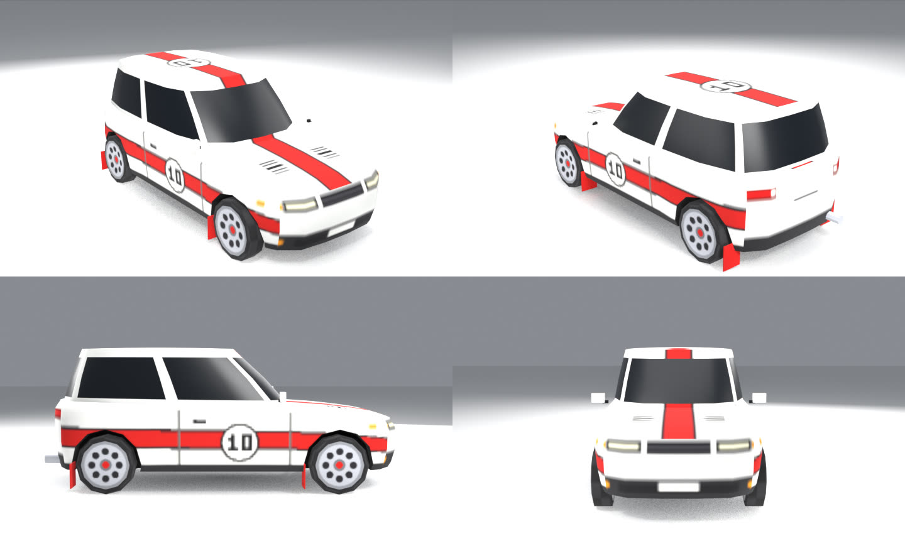 | **Xodó 1.0** | anos 1990-1995 | Hatch compacto popular | FWD | 87 cv | 930 kg |
|  | **Pipoca 1.3** | anos 1990-1995 | Hatch compacto popular | FWD | 95 cv | 1.000 kg |
| 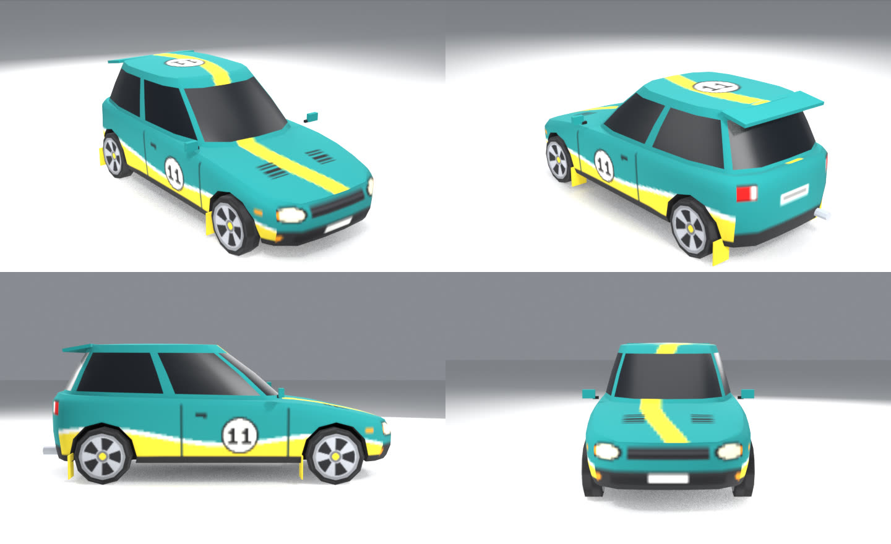 | **Cafuné 1.0** | anos 1996-2000 | Hatch compacto popular | FWD | 91 cv | 970 kg |
|  | **Quindim 1.6** | anos 1996-2000 | Hatch compacto popular | FWD | 103 cv | 1.050 kg |
|  | **Guri 1.4** | anos 2001-2005 | Hatch compacto popular | FWD | 98 cv | 1.020 kg |
|  | **Paçoca 1.4** | anos 2001-2005 | Monovolume compacto popular | FWD | 95 cv | 1.070 kg |
|  | **Chuchu 1.6** | anos 2006-2010 | Hatch compacto aventureiro | FWD | 103 cv | 1.080 kg |

### C2 Kit Car

Hatches esportivos preparados (kit car), tração dianteira.

| | Carro | Época | Arquétipo | Tração | Potência | Massa |
|---|---|---|---|---|---|---|
|  | **Chispa 18** | anos 1990-1995 | Hatch esportivo preparado (kit car) | FWD | 144 cv | 1.000 kg |
|  | **Fagulha 20** | anos 1990-1995 | Hatch esportivo preparado (kit car) | FWD | 156 cv | 950 kg |
|  | **Centelha 2.0** | anos 1996-2000 | Hatch esportivo preparado (kit car) | FWD | 165 cv | 1.030 kg |
|  | **Pavio 2.0** | anos 1996-2000 | Hatch esportivo preparado (kit car) | FWD | 152 cv | 960 kg |
|  | **Estopim 1.8** | anos 2001-2005 | Hatch esportivo preparado (kit car) | FWD | 159 cv | 980 kg |
|  | **Labareda 2.0** | anos 2001-2005 | Hatch esportivo preparado (kit car) | FWD | 169 cv | 1.050 kg |
|  | **Rojão 2.0** | anos 2006-2010 | Hatch esportivo preparado (kit car) | FWD | 173 cv | 1.060 kg |

### C3 Clássico

Cupês e sedãs de tração traseira.

| | Carro | Época | Arquétipo | Tração | Potência | Massa |
|---|---|---|---|---|---|---|
|  | **Braseiro 25** | anos 1990-1995 | Cupê de tração traseira | RWD | 162 cv | 1.020 kg |
| 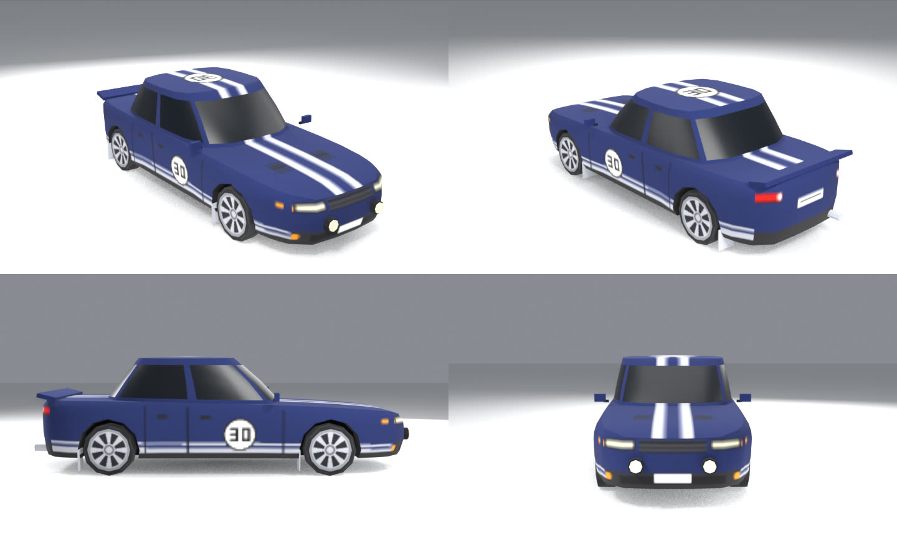 | **Tição 30** | anos 1990-1995 | Sedã de tração traseira | RWD | 178 cv | 1.120 kg |
|  | **Forja 26** | anos 1996-2000 | Sedã de tração traseira | RWD | 165 cv | 1.100 kg |
| 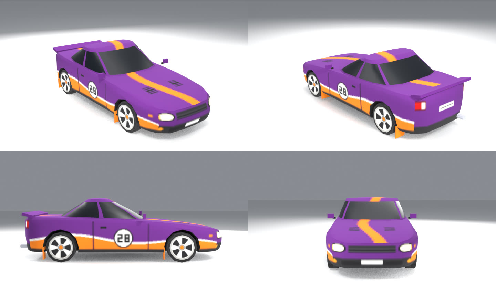 | **Fornalha 28** | anos 1996-2000 | Cupê de tração traseira | RWD | 174 cv | 1.000 kg |
|  | **Candeia 30** | anos 2001-2005 | Sedã de tração traseira | RWD | 184 cv | 1.080 kg |
|  | **Lampião 32** | anos 2001-2005 | Cupê de tração traseira | RWD | 188 cv | 1.050 kg |
|  | **Fogareiro 35** | anos 2006-2010 | Cupê de tração traseira | RWD | 185 cv | 1.110 kg |

### C4 Produção

Sedãs, hatches e peruas de série com tração integral e turbo.

| | Carro | Época | Arquétipo | Tração | Potência | Massa |
|---|---|---|---|---|---|---|
|  | **Relâmpago 20** | anos 1990-1995 | Sedã 4x4 turbo | AWD | 190 cv | 1.240 kg |
| 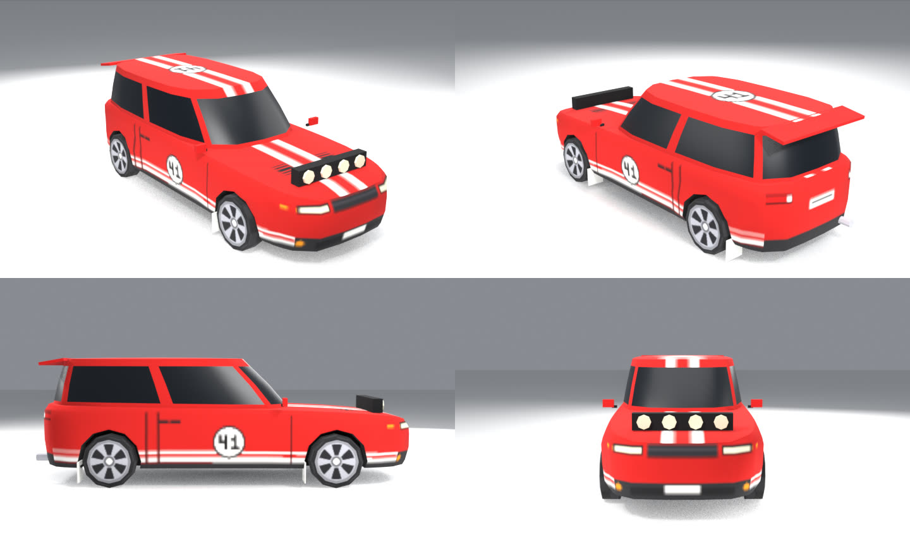 | **Trovoada 22** | anos 1990-1995 | Perua 4x4 turbo | AWD | 199 cv | 1.370 kg |
| 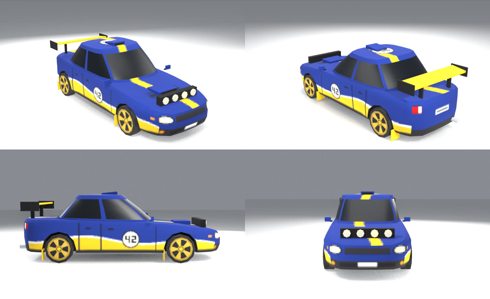 | **Temporal 20** | anos 1996-2000 | Sedã 4x4 turbo | AWD | 215 cv | 1.300 kg |
|  | **Rajada 20** | anos 1996-2000 | Hatch 4x4 turbo | AWD | 208 cv | 1.210 kg |
| 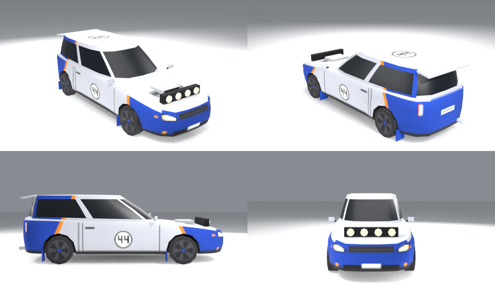 | **Tormenta 25** | anos 2001-2005 | Perua 4x4 turbo | AWD | 215 cv | 1.390 kg |
| 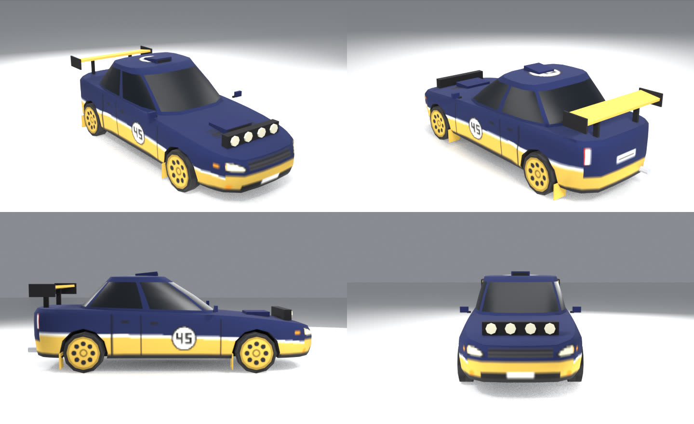 | **Borrasca 20** | anos 2001-2005 | Sedã 4x4 turbo | AWD | 224 cv | 1.330 kg |
|  | **Corisco 20** | anos 2006-2010 | Hatch 4x4 turbo | AWD | 220 cv | 1.270 kg |

### C5 Elite

Protótipos de rali sobre base de hatch, tração integral.

| | Carro | Época | Arquétipo | Tração | Potência | Massa |
|---|---|---|---|---|---|---|
|  | **Quartzo 16** | anos 1990-1995 | Protótipo de rali sobre base de hatch | AWD | 218 cv | 1.090 kg |
|  | **Basalto 16** | anos 1990-1995 | Protótipo de rali sobre base de hatch | AWD | 233 cv | 1.150 kg |
|  | **Granito 16** | anos 1996-2000 | Protótipo de rali sobre base de hatch | AWD | 224 cv | 1.180 kg |
|  | **Turmalina 16** | anos 1996-2000 | Protótipo de rali sobre base de hatch | AWD | 242 cv | 1.120 kg |
|  | **Jaspe 16** | anos 2001-2005 | Protótipo de rali sobre base de hatch | AWD | 228 cv | 1.210 kg |
|  | **Ágata 16** | anos 2001-2005 | Protótipo de rali sobre base de hatch | AWD | 249 cv | 1.150 kg |
|  | **Ametista 16** | anos 2006-2010 | Protótipo de rali sobre base de hatch | AWD | 238 cv | 1.230 kg |

### C6 Grupo Livre

Monstros sem restrição sobre base de hatch, tração integral.

| | Carro | Época | Arquétipo | Tração | Potência | Massa |
|---|---|---|---|---|---|---|
|  | **Ventania 21** | anos 1990-1995 | Monstro sem restrição sobre base de hatch | AWD | 301 cv | 1.030 kg |
| 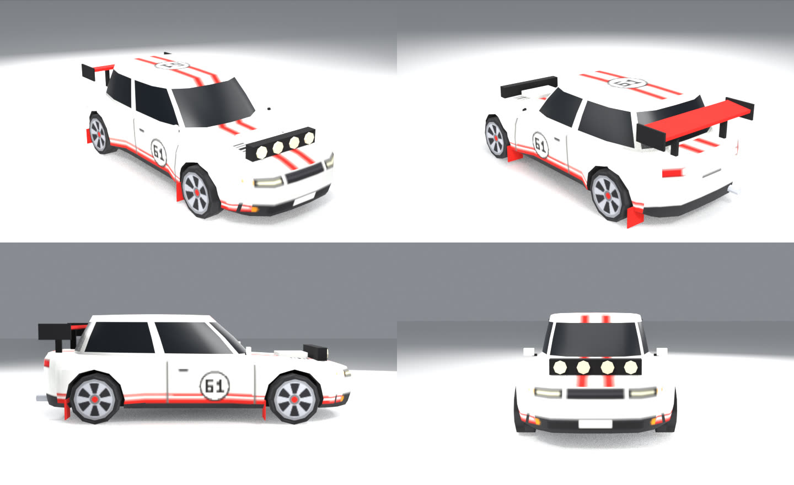 | **Redemoinho 22** | anos 1990-1995 | Monstro sem restrição sobre base de hatch | AWD | 330 cv | 1.100 kg |
|  | **Minuano 23** | anos 1996-2000 | Monstro sem restrição sobre base de hatch | AWD | 282 cv | 1.130 kg |
|  | **Lufada 24** | anos 1996-2000 | Monstro sem restrição sobre base de hatch | AWD | 318 cv | 1.060 kg |
|  | **Procela 25** | anos 2001-2005 | Monstro sem restrição sobre base de hatch | AWD | 337 cv | 1.170 kg |
|  | **Rebojo 26** | anos 2001-2005 | Monstro sem restrição sobre base de hatch | AWD | 294 cv | 1.100 kg |
|  | **Terral 27** | anos 2006-2010 | Monstro sem restrição sobre base de hatch | AWD | 325 cv | 1.190 kg |

### C7 Off-road

Picapes e utilitários de rali cross-country, tração integral.

| | Carro | Época | Arquétipo | Tração | Potência | Massa |
|---|---|---|---|---|---|---|
|  | **Atoleiro 31** | anos 1990-1995 | Picape de rali cross-country | AWD | 231 cv | 1.770 kg |
|  | **Lajedo 32** | anos 1990-1995 | Utilitário esportivo de rali cross-country | AWD | 239 cv | 1.900 kg |
|  | **Chapada 33** | anos 1996-2000 | Picape cabine dupla de rali cross-country | AWD | 252 cv | 2.000 kg |
|  | **Boqueirão 34** | anos 1996-2000 | Utilitário esportivo de rali cross-country | AWD | 264 cv | 1.860 kg |
|  | **Grota 35** | anos 2001-2005 | Picape cabine dupla de rali cross-country | AWD | 272 cv | 2.030 kg |
| 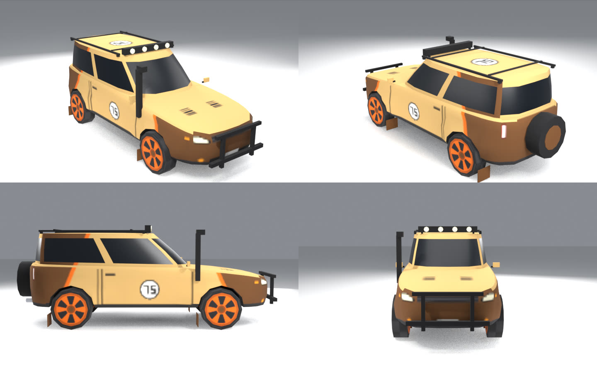 | **Caatinga 36** | anos 2001-2005 | Utilitário esportivo de rali cross-country | AWD | 257 cv | 1.900 kg |
| 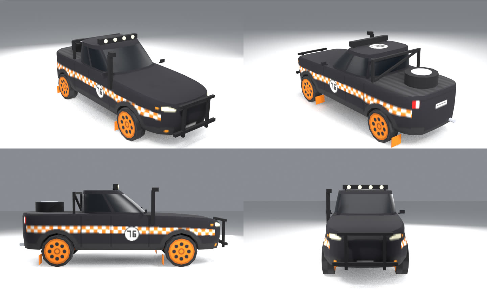 | **Tabuleiro 37** | anos 2006-2010 | Picape cabine dupla de rali cross-country | AWD | 277 cv | 2.050 kg |

## Pastas

- `modelos/<id>.glb`: o carro pronto para uso em tempo real.
- `texturas/`: as texturas da carroceria e das rodas em PNG (as mesmas que vão dentro do `.glb`).
- `previas/`: quatro vistas de cada carro.
- `fichas/<id>.json`: ficha do carro no jogo (nos carros da frota ampliada, com o campo `epoca`). A seção `fisica` traz massa, medidas, eixos, bitolas, rodas, potência e tração; a seção `forma` traz os parâmetros que geram a carroceria (perfil, cabine, faróis, cores, pintura e acessórios).

## Como usar os modelos

- Metros, eixo Y para cima. A frente do carro aponta para +Z e a esquerda para +X. A origem fica no chão, entre os eixos.
- Objetos de cada arquivo:
  - `Carroceria`: carroceria, vidros e acessórios numa malha só, com vários materiais.
  - `Roda_DE`, `Roda_DD`, `Roda_TE`, `Roda_TD`: as quatro rodas (dianteira/traseira, esquerda/direita), com a origem no centro da roda. Gire em torno do eixo X para rodar e em torno de Y para esterçar.
  - `Pinca_XX` (só no Scitizia R5): pinças de freio, que esterçam mas não giram.
  - `Sombra`: uma mancha escura com transparência para pôr no chão sob o carro.
- Materiais sem brilho combinam com o visual: difuso simples, filtro bilinear e neblina por distância.
