# Scitizia: 68 carros de rali low poly em glTF/GLB com visual retrô de 64 bits

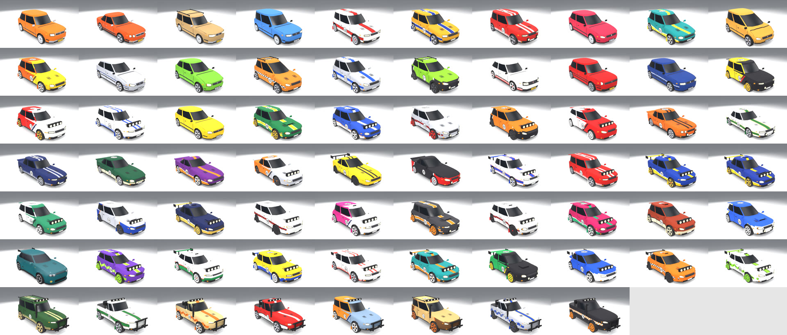

**Scitizia: frota 64 bits** é uma coleção gratuita de 68 carros de rali fictícios em baixo polígono (low poly), com o visual retrô dos consoles de 64 bits, prontos para jogos em tempo real. São 7 classes (C1 Novato a C7 Off-road), de hatches populares a picapes de rali cross-country, com épocas de estilo dos anos 1970 ao fim dos anos 2000. 12 deles são carros de rua de série de 4 marcas fictícias, com proporções e física de carros comuns de cada época. Cada carro é um arquivo glTF 2.0 binário (`.glb`) de 79 a 182 KB, com 2.008 a 3.362 triângulos, uma textura de 256×256 px para a carroceria e uma de 128×64 px para as rodas (os carros de rua têm mais uma, de 128×40 px, para as placas), rodas separadas para girar e esterçar e uma sombra plana. Os carros foram feitos para o jogo **Scitizia Rally Championship**; nomes, marcas, formas e pinturas são inventados, sem nenhum fabricante, modelo ou patrocinador real.

**English summary:** Scitizia 64-bit fleet is a free collection of 68 fictional low-poly rally cars with a retro 64-bit console look, in 7 classes (from small front-wheel-drive hatchbacks to cross-country rally pickups), including 12 stock street cars from 4 made-up brands. Every car is a binary glTF 2.0 (`.glb`) file with about 2,008 to 3,362 triangles, a 256×256 body texture and a 128×64 wheel texture, separate wheel objects for spinning and steering, and a blob shadow. Units are meters, Y is up and the car faces +Z. A machine-readable list of all cars is in [`catalogo.json`](catalogo.json).

## Resumo

| | |
|---|---|
| Carros | 68 em 7 classes (C1 16, C2 12, C3 8, C4 8, C5 8, C6 8, C7 8) |
| Formato | glTF 2.0 binário (`.glb`), texturas também em PNG |
| Triângulos por carro | 2.008 a 3.362 |
| Texturas | carroceria 256×256 px, rodas 128×64 px, placas 128×40 px (carros de rua) |
| Escala e eixos | metros, Y para cima, frente em +Z, esquerda em +X |
| Objetos | `Carroceria`, quatro rodas (`Roda_DE`, `Roda_DD`, `Roda_TE`, `Roda_TD`), `Sombra` |
| Épocas de estilo | anos 1970, anos 1980, anos 1990-1995, anos 1996-2000, anos 2001-2005, anos 2006-2010 |
| Carros de rua de série | 12, das marcas fictícias Ardena, Castrel, Nimbo, Vortan |
| Catálogo legível por máquina | [`catalogo.json`](catalogo.json) |

## Carros por classe

As tabelas trazem a época de estilo, o arquétipo, a tração (FWD dianteira, RWD traseira, AWD integral), a potência, a massa e o ID, o Índice de Desempenho do jogo (100 a 999), calculado a partir da ficha de física de cada carro. Dentro de cada classe os carros seguem a ordem das épocas. Os carros de rua de série trazem a marca fictícia ao lado do arquétipo.

### C1 Novato

Hatches compactos e monovolumes populares de rali e carros de rua de série (hatches, um monovolume, uma perua e um cupê), todos de tração dianteira e motor aspirado. 16 carros, ID de 312 a 394, potência de 58 a 116 cv, massa de 800 a 1.180 kg.

| Prévia | Carro | Época | Arquétipo | Tração | Potência | Massa | ID |
|---|---|---|---|---|---|---|---|
| 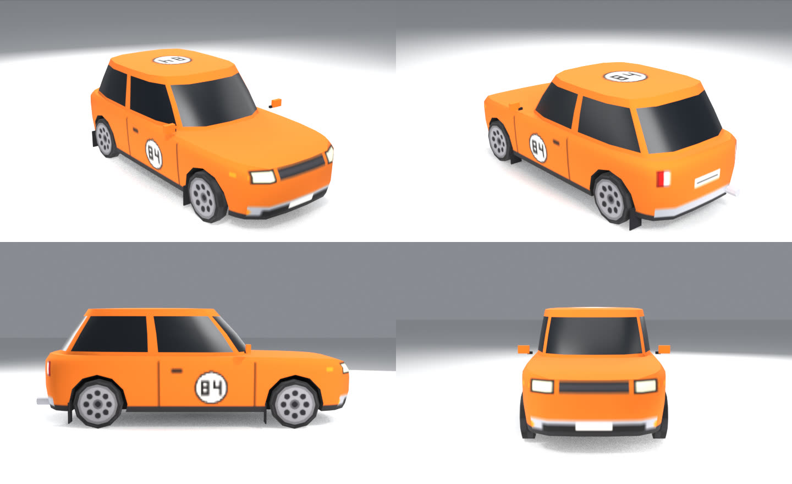 | **Bombom 1.3** | anos 1970 | Hatch pequeno de 3 portas (rua, Nimbo) | FWD | 61 cv | 820 kg | 319 |
| 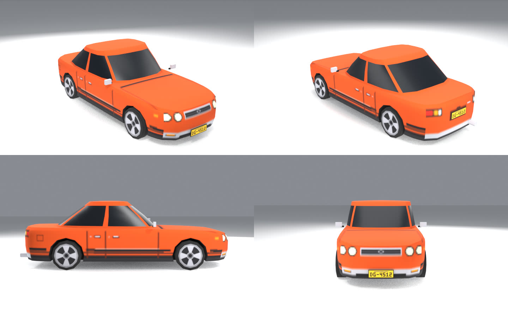 | **Dengo 1.6** | anos 1970 | Cupê médio de 2 portas (rua, Castrel) | FWD | 82 cv | 920 kg | 346 |
|  | **Rapadura 1.6** | anos 1980 | Perua média (rua, Castrel) | FWD | 75 cv | 960 kg | 318 |
| 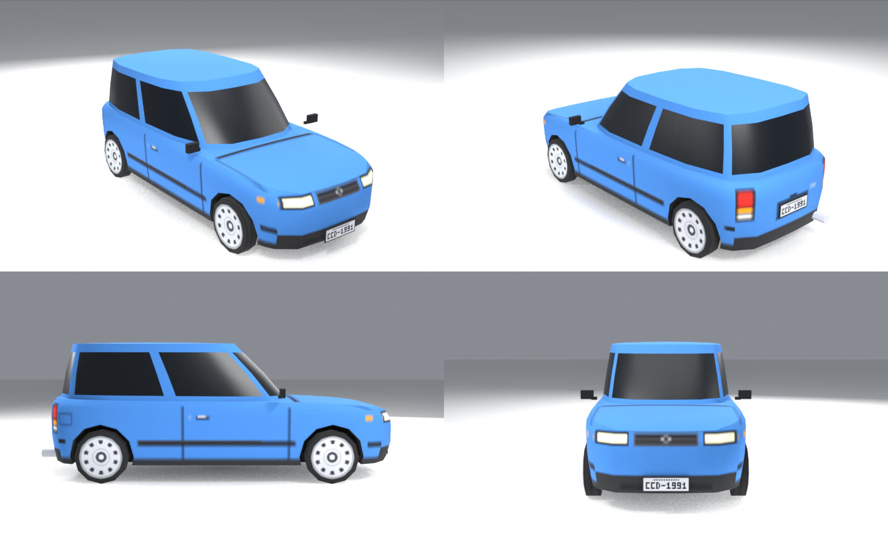 | **Cocada 1.0** | anos 1990-1995 | Hatch popular de linhas retas (rua, Nimbo) | FWD | 58 cv | 800 kg | 318 |
|  | **Xodó 1.0** | anos 1990-1995 | Hatch compacto popular | FWD | 87 cv | 930 kg | 361 |
| 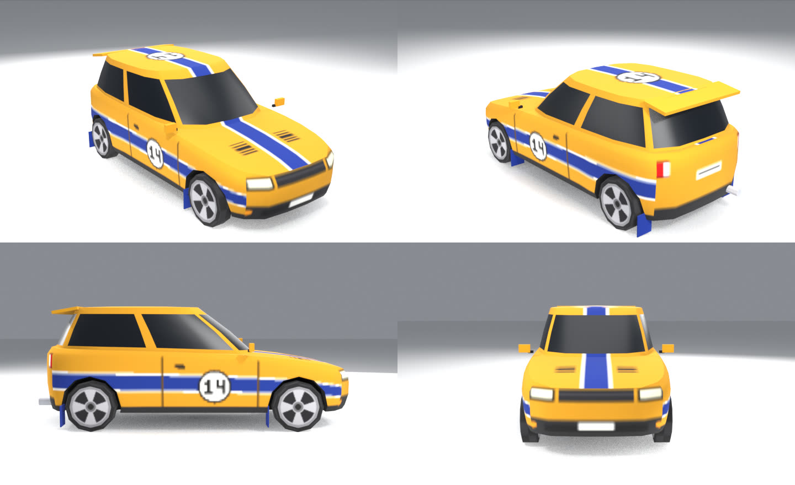 | **Miúdo 1.4** | anos 1990-1995 | Hatch compacto popular | FWD | 95 cv | 1.000 kg | 373 |
|  | **Pipoca 1.3** | anos 1990-1995 | Hatch compacto popular | FWD | 95 cv | 1.000 kg | 373 |
| 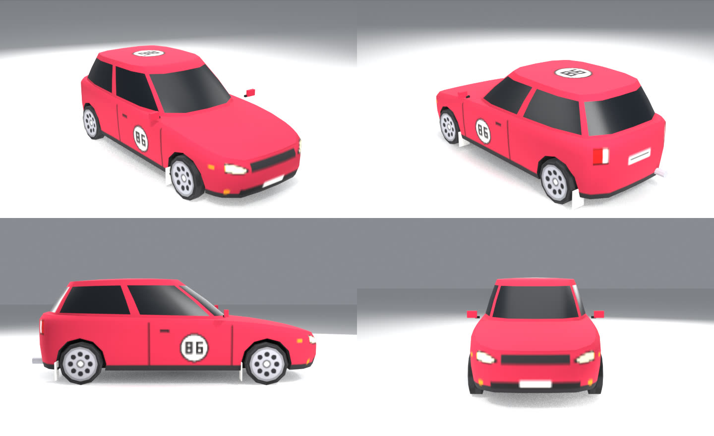 | **Pirulito 1.0** | anos 1996-2000 | Hatch compacto popular (rua, Castrel) | FWD | 60 cv | 880 kg | 312 |
|  | **Cafuné 1.0** | anos 1996-2000 | Hatch compacto popular | FWD | 91 cv | 970 kg | 367 |
|  | **Pudim 1.6** | anos 1996-2000 | Monovolume compacto de piso duplo (rua, Ardena) | FWD | 102 cv | 1.120 kg | 368 |
| 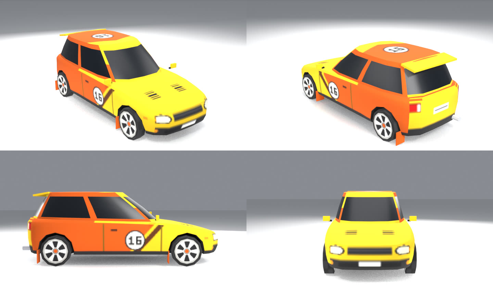 | **Quindim 1.6** | anos 1996-2000 | Hatch compacto popular | FWD | 103 cv | 1.050 kg | 389 |
| 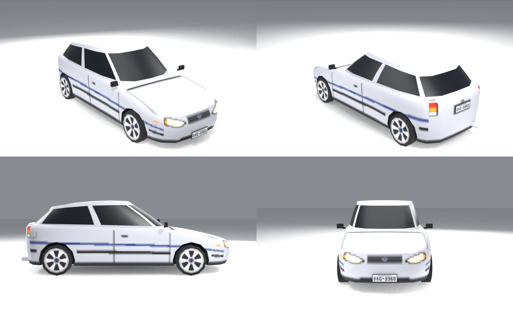 | **Brigadeiro 1.8** | anos 1996-2000 | Hatch médio de linhas angulosas (rua, Castrel) | FWD | 116 cv | 1.180 kg | 394 |
|  | **Jujuba 1.0** | anos 2001-2005 | Subcompacto de linhas arredondadas (rua, Castrel) | FWD | 65 cv | 900 kg | 327 |
|  | **Paçoca 1.4** | anos 2001-2005 | Monovolume compacto popular | FWD | 95 cv | 1.070 kg | 358 |
| 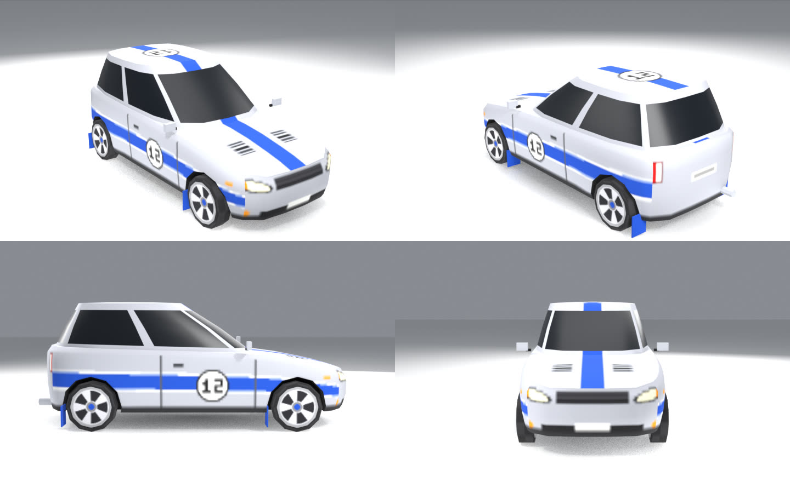 | **Guri 1.4** | anos 2001-2005 | Hatch compacto popular | FWD | 98 cv | 1.020 kg | 373 |
| 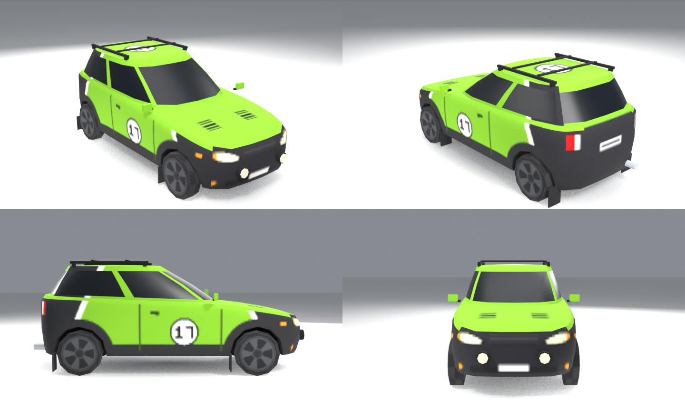 | **Chuchu 1.6** | anos 2006-2010 | Hatch compacto aventureiro | FWD | 103 cv | 1.080 kg | 372 |

### C2 Kit Car

Hatches esportivos preparados (kit car) e hatches médios esportivos de série, tração dianteira e motor aspirado ou turbo. 12 carros, ID de 412 a 560, potência de 105 a 173 cv, massa de 940 a 1.230 kg.

| Prévia | Carro | Época | Arquétipo | Tração | Potência | Massa | ID |
|---|---|---|---|---|---|---|---|
| 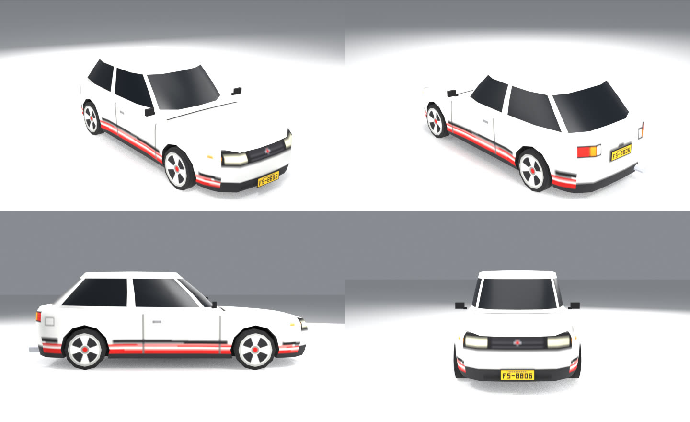 | **Fósforo 16** | anos 1980 | Hatch esportivo de 3 portas (rua, Castrel) | FWD | 105 cv | 950 kg | 412 |
| 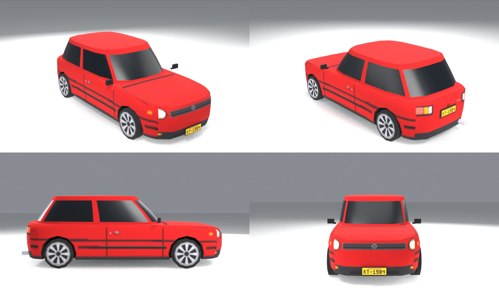 | **Rastilho 18** | anos 1980 | Hatch médio esportivo de 3 portas (rua, Vortan) | FWD | 112 cv | 940 kg | 435 |
|  | **Lampejo 20** | anos 1990-1995 | Hatch médio esportivo (rua, Vortan) | FWD | 150 cv | 1.150 kg | 480 |
| 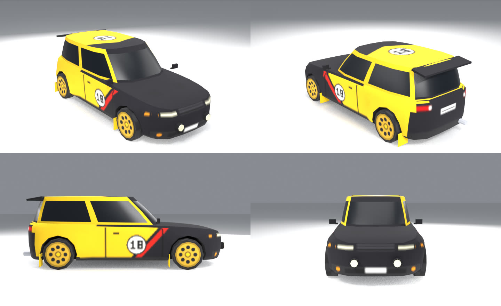 | **Chispa 18** | anos 1990-1995 | Hatch esportivo preparado (kit car) | FWD | 144 cv | 1.000 kg | 506 |
|  | **Faísca KC** | anos 1990-1995 | Hatch esportivo preparado (kit car) | FWD | 156 cv | 1.000 kg | 540 |
|  | **Fagulha 20** | anos 1990-1995 | Hatch esportivo preparado (kit car) | FWD | 156 cv | 950 kg | 556 |
|  | **Pólvora 18** | anos 1996-2000 | Hatch médio esportivo turbo (rua, Vortan) | FWD | 150 cv | 1.230 kg | 463 |
| 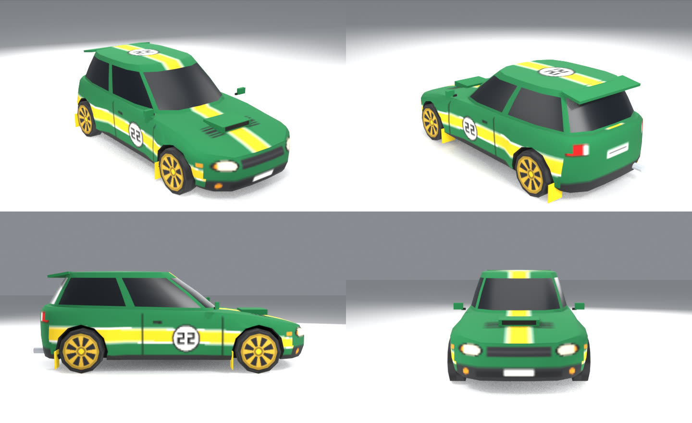 | **Pavio 2.0** | anos 1996-2000 | Hatch esportivo preparado (kit car) | FWD | 152 cv | 960 kg | 541 |
| 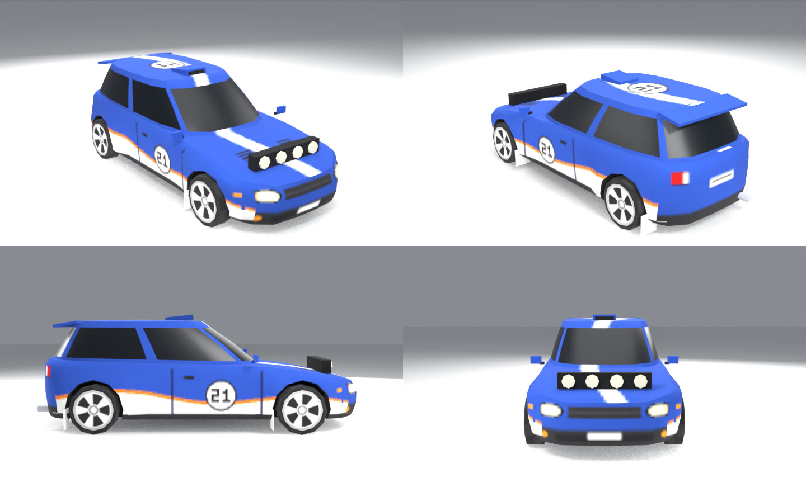 | **Centelha 2.0** | anos 1996-2000 | Hatch esportivo preparado (kit car) | FWD | 165 cv | 1.030 kg | 551 |
| 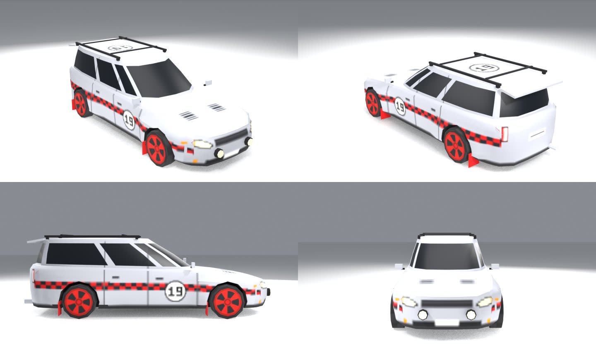 | **Estopim 1.8** | anos 2001-2005 | Hatch esportivo preparado (kit car) | FWD | 159 cv | 980 kg | 553 |
| 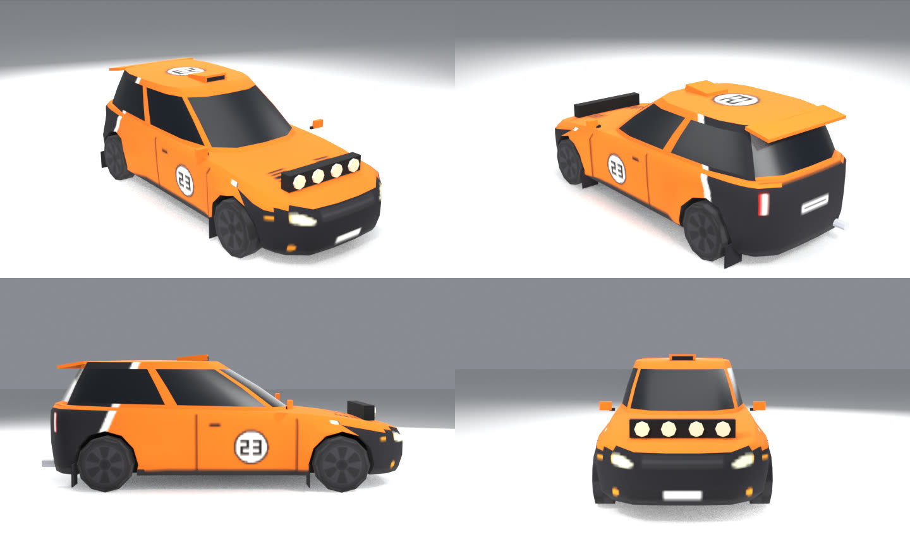 | **Labareda 2.0** | anos 2001-2005 | Hatch esportivo preparado (kit car) | FWD | 169 cv | 1.050 kg | 553 |
|  | **Rojão 2.0** | anos 2006-2010 | Hatch esportivo preparado (kit car) | FWD | 173 cv | 1.060 kg | 560 |

### C3 Clássico

Cupês e sedãs de tração traseira, motores aspirados de 2.4 a 3.5. 8 carros, ID de 503 a 572, potência de 162 a 188 cv, massa de 1.000 a 1.120 kg.

| Prévia | Carro | Época | Arquétipo | Tração | Potência | Massa | ID |
|---|---|---|---|---|---|---|---|
|  | **Brasa 24** | anos 1980 | Cupê de tração traseira dos anos 70/80 | RWD | 170 cv | 1.050 kg | 529 |
|  | **Braseiro 25** | anos 1990-1995 | Cupê de tração traseira | RWD | 162 cv | 1.020 kg | 521 |
|  | **Tição 30** | anos 1990-1995 | Sedã de tração traseira | RWD | 178 cv | 1.120 kg | 524 |
|  | **Forja 26** | anos 1996-2000 | Sedã de tração traseira | RWD | 165 cv | 1.100 kg | 503 |
|  | **Fornalha 28** | anos 1996-2000 | Cupê de tração traseira | RWD | 174 cv | 1.000 kg | 558 |
|  | **Candeia 30** | anos 2001-2005 | Sedã de tração traseira | RWD | 184 cv | 1.080 kg | 550 |
| 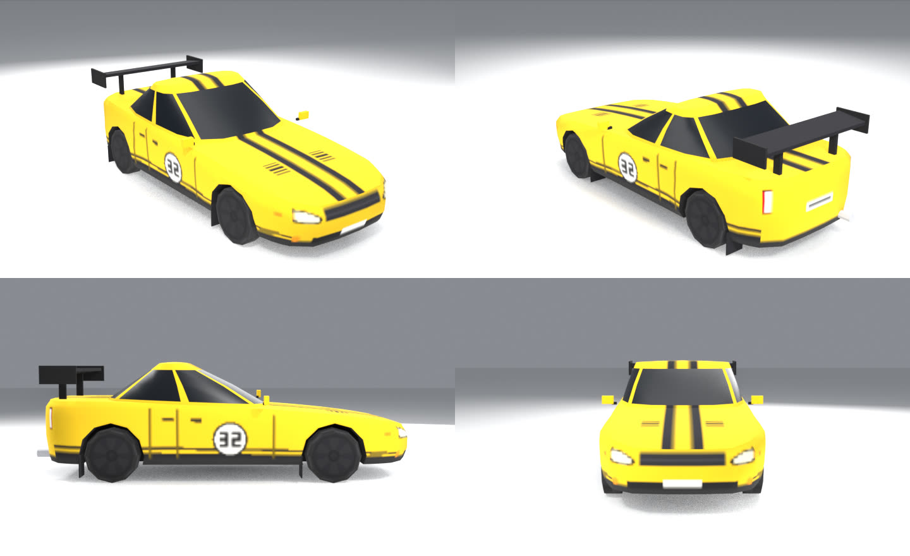 | **Lampião 32** | anos 2001-2005 | Cupê de tração traseira | RWD | 188 cv | 1.050 kg | 572 |
| 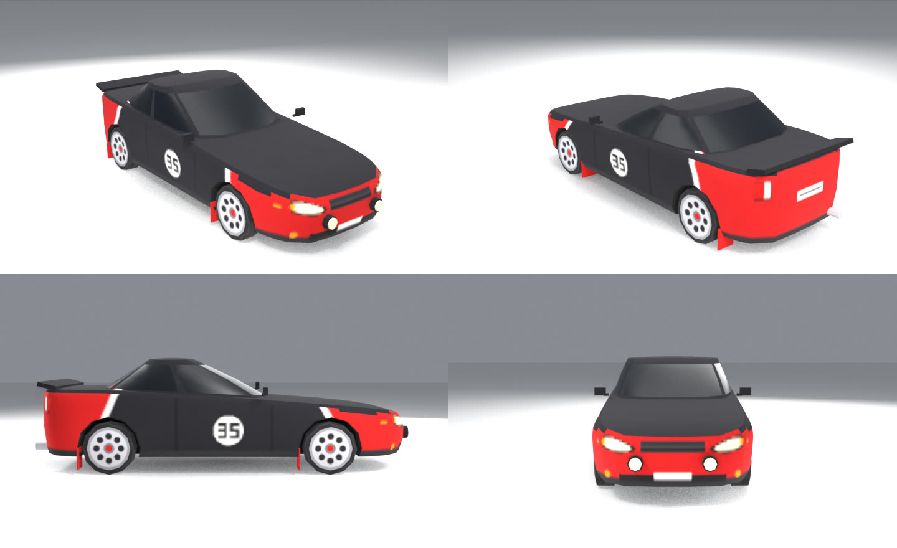 | **Fogareiro 35** | anos 2006-2010 | Cupê de tração traseira | RWD | 185 cv | 1.110 kg | 547 |

### C4 Produção

Sedãs, hatches e peruas de série com tração integral e motor turbo. 8 carros, ID de 599 a 640, potência de 190 a 224 cv, massa de 1.210 a 1.390 kg.

| Prévia | Carro | Época | Arquétipo | Tração | Potência | Massa | ID |
|---|---|---|---|---|---|---|---|
| 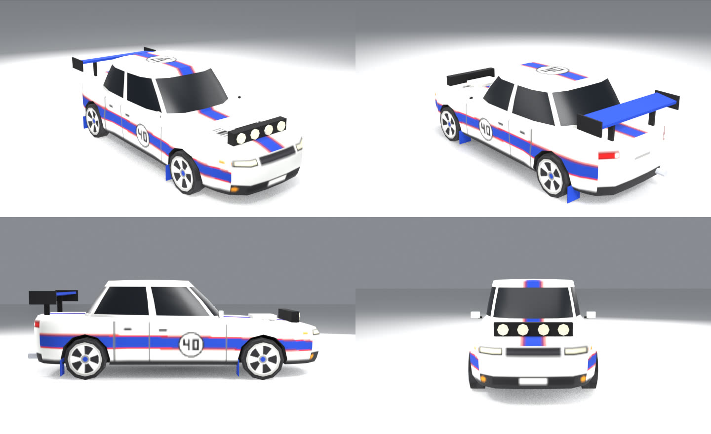 | **Relâmpago 20** | anos 1990-1995 | Sedã 4x4 turbo | AWD | 190 cv | 1.240 kg | 599 |
|  | **Trovoada 22** | anos 1990-1995 | Perua 4x4 turbo | AWD | 199 cv | 1.290 kg | 604 |
| 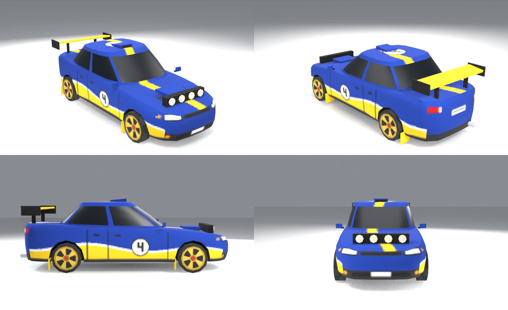 | **Trovão 4T** | anos 1990-1995 | Sedã de série 4x4 turbo | AWD | 204 cv | 1.300 kg | 605 |
|  | **Temporal 20** | anos 1996-2000 | Sedã 4x4 turbo | AWD | 215 cv | 1.300 kg | 625 |
| 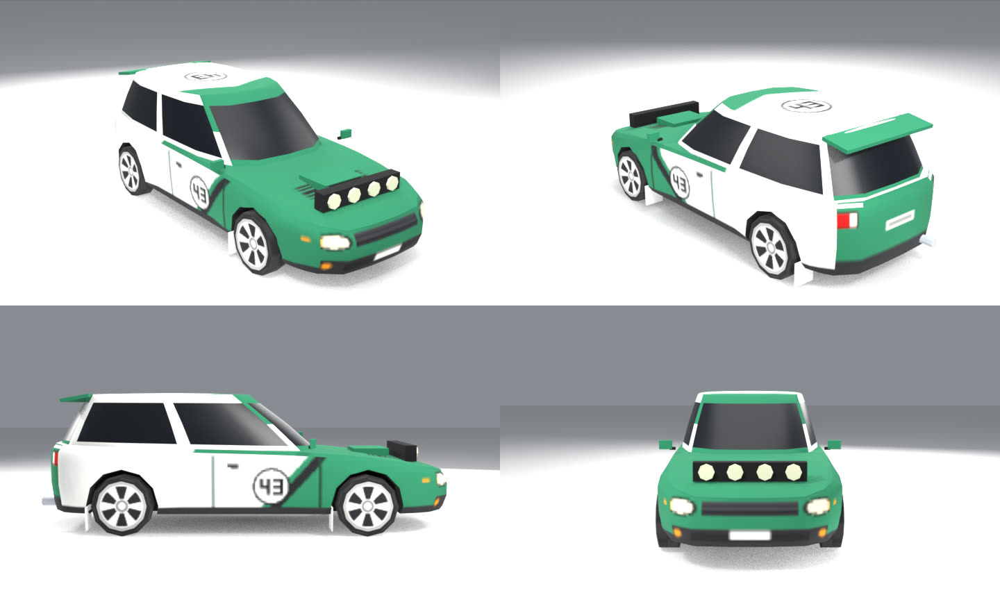 | **Rajada 20** | anos 1996-2000 | Hatch 4x4 turbo | AWD | 208 cv | 1.210 kg | 636 |
|  | **Tormenta 25** | anos 2001-2005 | Perua 4x4 turbo | AWD | 215 cv | 1.390 kg | 602 |
|  | **Borrasca 20** | anos 2001-2005 | Sedã 4x4 turbo | AWD | 224 cv | 1.330 kg | 636 |
| 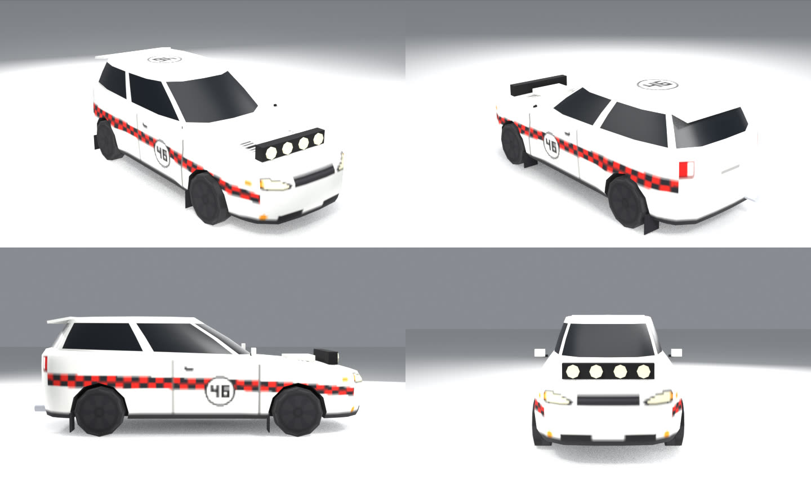 | **Corisco 20** | anos 2006-2010 | Hatch 4x4 turbo | AWD | 220 cv | 1.270 kg | 640 |

### C5 Elite

Protótipos de rali sobre base de hatch, tração integral e motor 1.6 turbo. 8 carros, ID de 686 a 747, potência de 218 a 249 cv, massa de NaN a NaN kg.

| Prévia | Carro | Época | Arquétipo | Tração | Potência | Massa | ID |
|---|---|---|---|---|---|---|---|
| 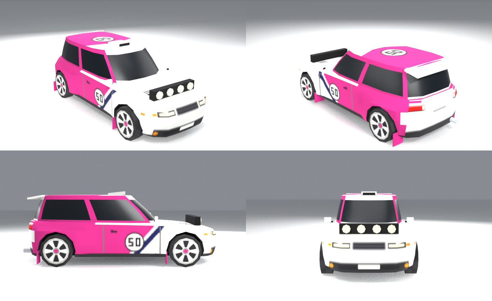 | **Quartzo 16** | anos 1990-1995 | Protótipo de rali sobre base de hatch | AWD | 218 cv | 1.090 kg | 702 |
|  | **Basalto 16** | anos 1990-1995 | Protótipo de rali sobre base de hatch | AWD | 233 cv | 1.150 kg | 713 |
| 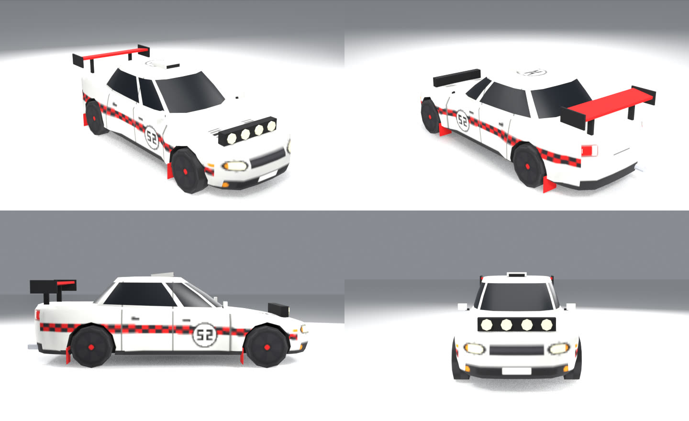 | **Granito 16** | anos 1996-2000 | Protótipo de rali sobre base de hatch | AWD | 224 cv | 1.180 kg | 686 |
| 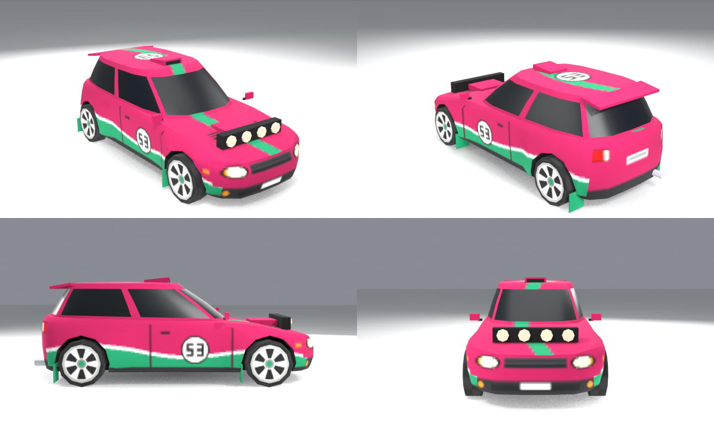 | **Turmalina 16** | anos 1996-2000 | Protótipo de rali sobre base de hatch | AWD | 242 cv | 1.120 kg | 746 |
| 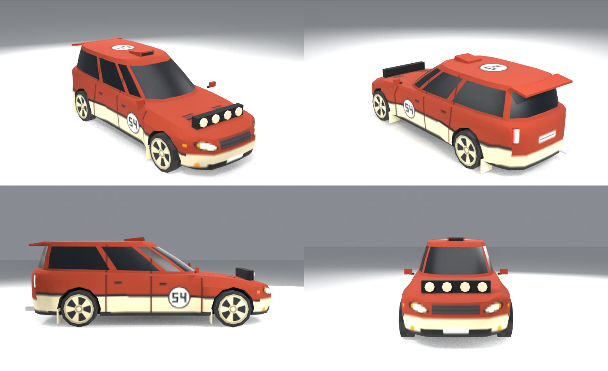 | **Jaspe 16** | anos 2001-2005 | Protótipo de rali sobre base de hatch | AWD | 228 cv | 1.150 kg | 702 |
|  | **Ágata 16** | anos 2001-2005 | Protótipo de rali sobre base de hatch | AWD | 249 cv | 1.150 kg | 747 |
| 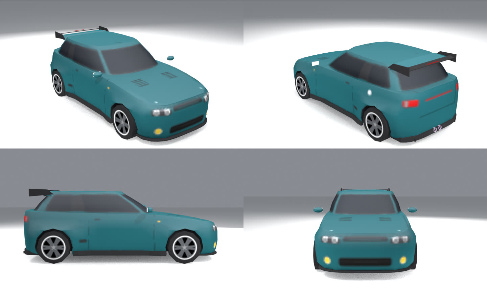 | **Scitizia R5** | anos 2006-2010 | Protótipo de rali sobre base de hatch | AWD | 228 cv | NaN kg | 708 |
| 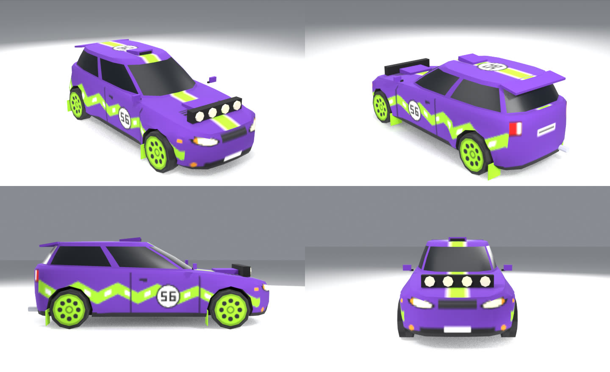 | **Ametista 16** | anos 2006-2010 | Protótipo de rali sobre base de hatch | AWD | 238 cv | 1.170 kg | 718 |

### C6 Grupo Livre

Monstros sem restrição sobre base de hatch, tração integral e motores turbo de 2.1 a 2.7. 8 carros, ID de 829 a 922, potência de 282 a 337 cv, massa de 1.030 a 1.190 kg.

| Prévia | Carro | Época | Arquétipo | Tração | Potência | Massa | ID |
|---|---|---|---|---|---|---|---|
| 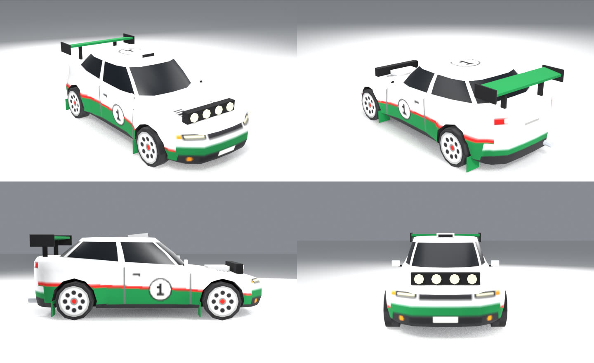 | **Vendaval B** | anos 1980 | Monstro sem restrição, estilo anos 80 | AWD | 306 cv | 1.100 kg | 896 |
| 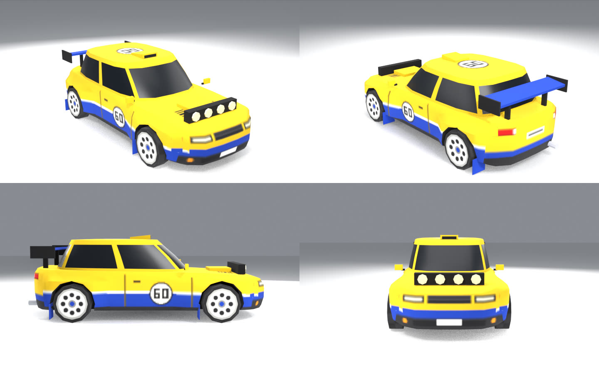 | **Ventania 21** | anos 1990-1995 | Monstro sem restrição sobre base de hatch | AWD | 301 cv | 1.030 kg | 909 |
|  | **Redemoinho 22** | anos 1990-1995 | Monstro sem restrição sobre base de hatch | AWD | 330 cv | 1.100 kg | 919 |
|  | **Minuano 23** | anos 1996-2000 | Monstro sem restrição sobre base de hatch | AWD | 282 cv | 1.130 kg | 829 |
|  | **Lufada 24** | anos 1996-2000 | Monstro sem restrição sobre base de hatch | AWD | 318 cv | 1.060 kg | 914 |
| 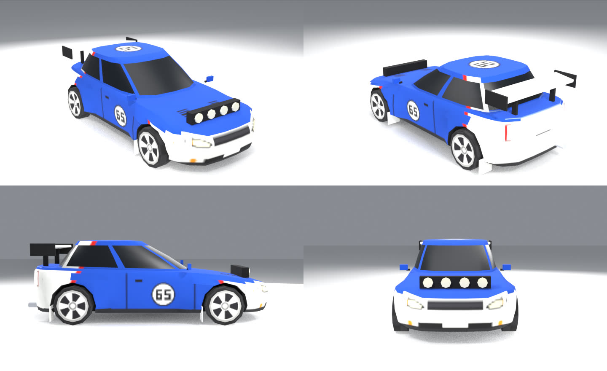 | **Rebojo 26** | anos 2001-2005 | Monstro sem restrição sobre base de hatch | AWD | 294 cv | 1.100 kg | 869 |
| 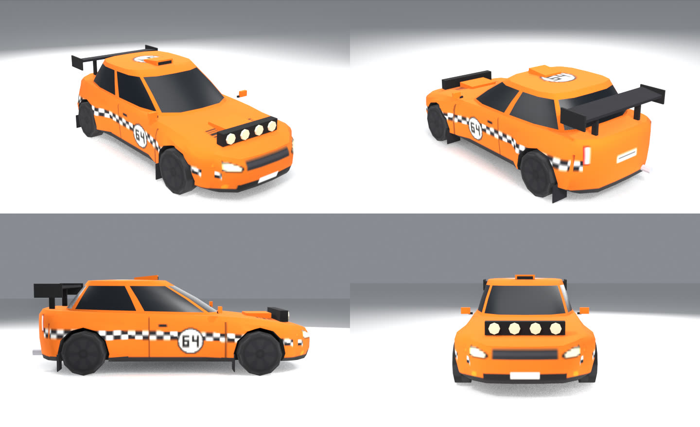 | **Procela 25** | anos 2001-2005 | Monstro sem restrição sobre base de hatch | AWD | 337 cv | 1.170 kg | 922 |
| 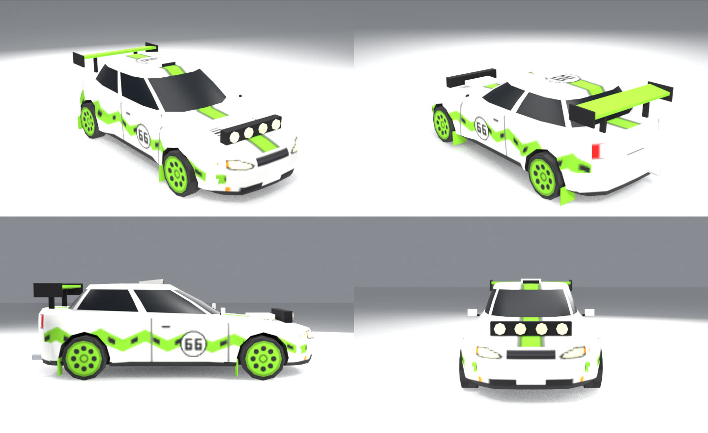 | **Terral 27** | anos 2006-2010 | Monstro sem restrição sobre base de hatch | AWD | 325 cv | 1.190 kg | 893 |

### C7 Off-road

Picapes e utilitários esportivos de rali cross-country, tração integral, os carros mais pesados da frota. 8 carros, ID de 501 a 543, potência de 231 a 277 cv, massa de 1.770 a 2.050 kg.

| Prévia | Carro | Época | Arquétipo | Tração | Potência | Massa | ID |
|---|---|---|---|---|---|---|---|
|  | **Lajedo 32** | anos 1990-1995 | Utilitário esportivo de rali cross-country | AWD | 239 cv | 1.900 kg | 501 |
| 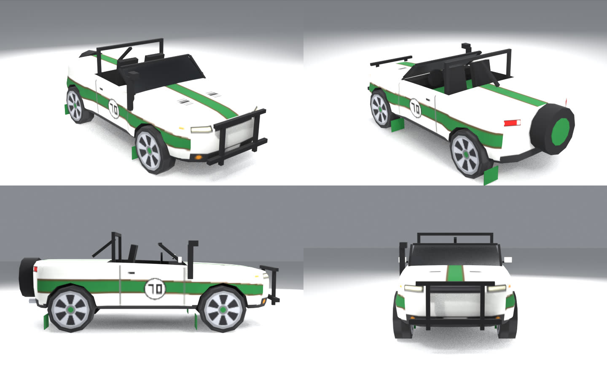 | **Atoleiro 31** | anos 1990-1995 | Picape de rali cross-country | AWD | 231 cv | 1.770 kg | 508 |
|  | **Jararaca 30** | anos 1990-1995 | Picape de rali cross-country | AWD | 252 cv | 1.900 kg | 521 |
| 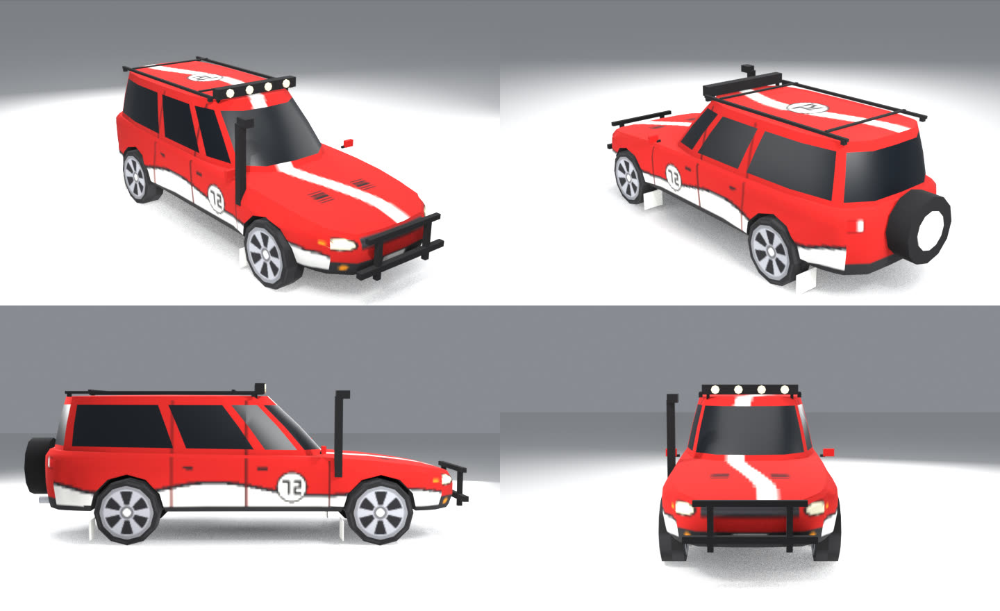 | **Chapada 33** | anos 1996-2000 | Picape cabine dupla de rali cross-country | AWD | 252 cv | 2.000 kg | 507 |
| 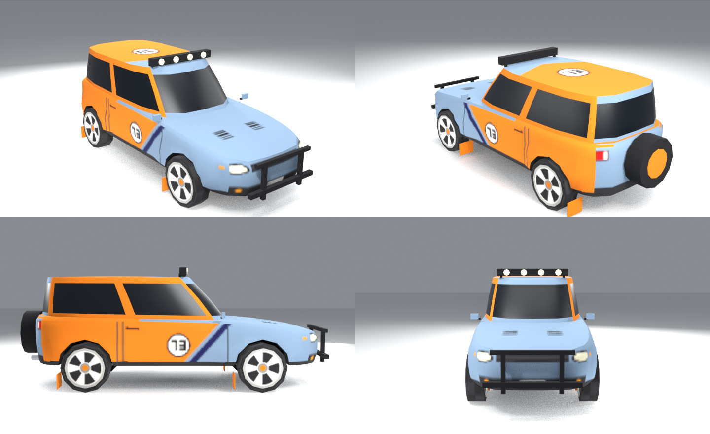 | **Boqueirão 34** | anos 1996-2000 | Utilitário esportivo de rali cross-country | AWD | 264 cv | 1.860 kg | 543 |
|  | **Caatinga 36** | anos 2001-2005 | Utilitário esportivo de rali cross-country | AWD | 257 cv | 1.900 kg | 528 |
| 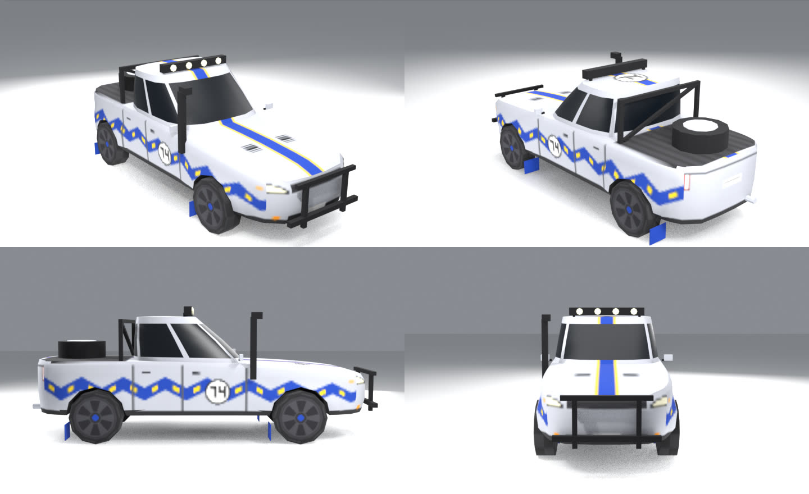 | **Grota 35** | anos 2001-2005 | Picape cabine dupla de rali cross-country | AWD | 272 cv | 2.030 kg | 530 |
|  | **Tabuleiro 37** | anos 2006-2010 | Picape cabine dupla de rali cross-country | AWD | 277 cv | 2.050 kg | 534 |

## Carros de rua de série

Os 12 carros de rua usam proporções de carros comuns de cada época (comprimento, entre-eixos, altura, balanço, rodas pequenas de aro 13 a 16) e física de carro de série: massa, potência, torque, escalonamento de marchas e relação final do tipo de carro. As marcas são inventadas e aparecem no campo `marca` da ficha e do catálogo. Eles saem com acabamento de série (`"decoracao": "rua"` na ficha): sem número de competição, faixas no capô, faróis de milha nem para-barros, com placa de época inventada (amarela até os anos 80, cinza depois), frisos, maçanetas, lanternas com moldura, retrovisores pretos ou cromados, calotas e pneus de rua.

| Carro | Classe | Marca fictícia | Época | Tipo de carro |
|---|---|---|---|---|
| **Bombom 1.3** | C1 | Nimbo | anos 1970 | Hatch pequeno de 3 portas |
| **Dengo 1.6** | C1 | Castrel | anos 1970 | Cupê médio de 2 portas |
| **Rapadura 1.6** | C1 | Castrel | anos 1980 | Perua média |
| **Cocada 1.0** | C1 | Nimbo | anos 1990-1995 | Hatch popular de linhas retas |
| **Pirulito 1.0** | C1 | Castrel | anos 1996-2000 | Hatch compacto popular |
| **Pudim 1.6** | C1 | Ardena | anos 1996-2000 | Monovolume compacto de piso duplo |
| **Brigadeiro 1.8** | C1 | Castrel | anos 1996-2000 | Hatch médio de linhas angulosas |
| **Jujuba 1.0** | C1 | Castrel | anos 2001-2005 | Subcompacto de linhas arredondadas |
| **Fósforo 16** | C2 | Castrel | anos 1980 | Hatch esportivo de 3 portas |
| **Rastilho 18** | C2 | Vortan | anos 1980 | Hatch médio esportivo de 3 portas |
| **Lampejo 20** | C2 | Vortan | anos 1990-1995 | Hatch médio esportivo |
| **Pólvora 18** | C2 | Vortan | anos 1996-2000 | Hatch médio esportivo turbo |

## Épocas de estilo

A época de cada carro aparece só nas proporções e nos detalhes da carroceria:

- **anos 1970**: carrocerias baixas de linhas retas, faróis redondos ou retangulares e para-choques cromados;
- **anos 1980**: carrocerias retas de cantos vivos, faróis retangulares ou redondos, para-choques escuros ou cromados e, nos carros de rali, muitos acessórios;
- **anos 1990-1995**: linhas retas, para-brisa mais em pé, faróis retangulares finos e para-choques escuros;
- **anos 1996-2000**: formas arredondadas, faróis ovais, cintura baixa; os de linhas angulosas têm teto em arco e lanternas altas;
- **anos 2001-2005**: carrocerias mais altas, para-brisa mais deitado, faróis em gota e para-choques na cor do carro;
- **anos 2006-2010**: cintura alta, janelas menores, faróis grandes e puxados; os aventureiros ganham protetores de plástico.

## Pastas

- `modelos/<id>.glb`: o carro pronto para uso em tempo real.
- `texturas/<id>_carroceria.png` e `texturas/<id>_roda.png` (e `texturas/<id>_placa.png` nos carros de rua): as texturas em PNG (as mesmas que vão dentro do `.glb`).
- `previas/<id>.jpg`: quatro vistas de cada carro.
- `fichas/<id>.json`: ficha do carro no jogo, com nome, classe, época, arquétipo, motor e tração (e a marca fictícia, nos carros de rua). A seção `fisica` traz massa, medidas, eixos, bitolas, rodas, potência e tração; a seção `forma` traz os parâmetros que geram a carroceria (perfil, cabine, faróis, cores, pintura e acessórios).
- `catalogo.json`: lista dos 68 carros com classe, época, arquétipo, tração, potência, massa, ID e os caminhos do modelo, da prévia, da ficha e das texturas.
- `docs/`: imagem de capa.

## Como usar os modelos

- Metros, eixo Y para cima. A frente do carro aponta para +Z e a esquerda para +X. A origem fica no chão, entre os eixos.
- Objetos de cada arquivo:
  - `Carroceria`: carroceria, vidros e acessórios numa malha só, com vários materiais.
  - `Roda_DE`, `Roda_DD`, `Roda_TE`, `Roda_TD`: as quatro rodas (dianteira/traseira, esquerda/direita), com a origem no centro da roda. Gire em torno do eixo X para rodar e em torno de Y para esterçar.
  - `Pinca_XX` (só no Scitizia R5): pinças de freio, que esterçam mas não giram.
  - `Sombra`: uma mancha escura com transparência para pôr no chão sob o carro.
- Materiais sem brilho combinam com o visual: difuso simples, filtro bilinear e neblina por distância.

## Perguntas frequentes

**Em que formato estão os carros?**
Em glTF 2.0 binário (`.glb`), um arquivo por carro, com malhas, materiais e texturas embutidos. As texturas também estão soltas em PNG na pasta `texturas/`.

**Qual a escala e a orientação dos modelos?**
A escala é em metros, com Y para cima, a frente do carro em +Z e a esquerda em +X. A origem fica no chão, no meio do entre-eixos.

**Posso importar em qualquer motor de jogo ou programa 3D?**
Sim, em qualquer motor, biblioteca web ou editor 3D que leia glTF 2.0. Não há extensões proprietárias: só malhas, materiais simples e texturas PNG.

**Quantos triângulos tem cada carro?**
Entre 2.008 e 3.362 triângulos, contando carroceria, rodas e sombra. Os arquivos têm de 79 a 182 KB.

**Que texturas os carros usam?**
Uma textura de 256×256 px para a carroceria (pintura, faróis, números e detalhes) e uma de 128×64 px para as rodas; os carros de rua têm mais uma, de 128×40 px, com a placa. O visual pede filtro bilinear e materiais sem brilho.

**As rodas giram e esterçam?**
Sim. Cada roda é um objeto separado com a origem no centro: gire em torno do eixo X para rodar e em torno do eixo Y para esterçar.

**Os carros copiam modelos reais?**
Não. Todos os carros, nomes, marcas e pinturas são fictícios, inspirados só em arquétipos genéricos (hatch popular, kit car, cupê de tração traseira, sedã 4x4 turbo, protótipo, picape cross-country, carros de rua comuns de cada época), sem fabricante, modelo ou patrocinador real.

**O que tem nas fichas JSON?**
Cada `fichas/<id>.json` traz identificação (nome, classe, época, arquétipo, motor, tração e, nos carros de rua, a marca fictícia e o torque), a seção `fisica` usada pelo jogo (massa, medidas, eixos, bitolas, raio das rodas, potência, marchas) e a seção `forma`, com os parâmetros que geram a carroceria.

**O que é o ID das tabelas?**
É o Índice de Desempenho do jogo, de 100 a 999, que combina relação peso/potência, velocidade máxima, tração, dirigibilidade e frenagem. Serve para comparar carros de classes diferentes.

**Como listar os carros num programa?**
Leia o [`catalogo.json`](catalogo.json): ele traz os 68 carros com todos os dados das tabelas e os caminhos dos arquivos de cada um.

## Como citar

Os metadados de citação estão em [`CITATION.cff`](CITATION.cff).
